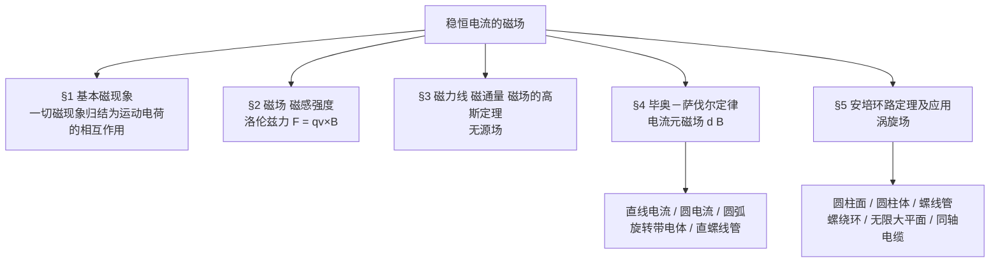

---
tags:
  - 物理
  - 电磁学
  - 磁场
aliases:
  - 稳恒电流的磁场
  - 恒定磁场
---

> 大学物理（2）电磁学部分 · **真空中的稳恒电流磁场**。本章把研究对象从「静止电荷」换成「稳恒电流（运动电荷）」，建立磁场的描述方式与两条基本定理。

## 课程信息

| 项目 | 内容 |
|---|---|
| 课程 | 大学物理（2）电磁学 |
| 章节 | 真空中的稳恒电流磁场 |
| 教材 | 华北电力大学《稳恒电流磁场》 |
| 主线 | 磁现象 → 磁感强度 → 磁通量与高斯定理 → 毕奥－萨伐尔定律 → 安培环路定理 |

## 本章讲什么

静电场的逻辑是「两个物理量 + 一个实验规律 + 两个定理」，磁场完全平行：

- **两个物理量**：磁感应强度 $\vec{B}$、磁通量 $\Phi_m$；
- **一个实验规律**：毕奥－萨伐尔定律（电流元产生磁场的规律）；
- **两个定理**：磁场的高斯定理、安培环路定理。

一个要先记住的差别：静电场是**有源无旋**场（电荷是源，环流为零），稳恒磁场是**无源有旋**场（没有磁单极子，环流不为零）。

## 知识框架

## 主题导航

- [[基本磁现象与磁感应强度]] — 磁现象的本质、磁场的基本性质、磁感应强度的定义与洛伦兹力
- [[磁通量与磁场的高斯定理]] — 磁力线的性质、磁通量及其计算、磁场的高斯定理（无源场）
- [[毕奥-萨伐尔定律]] — 电流元磁场、矢量积分的一般步骤、磁矩
- [[典型载流体的磁场]] — 直线电流、圆电流轴线、圆弧、旋转带电体、直螺线管的磁场公式速查
- [[安培环路定理]] — 定理的表述与理解、求磁场的方法、五大典型应用与同轴电缆

---

[[ATLAS/卷5 大学物理/目录|← 返回卷5 大学物理]]
