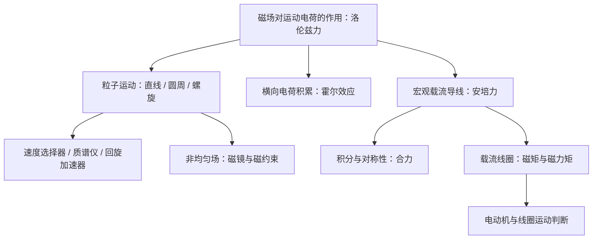

---
tags:
  - 目录
  - 物理
  - 电磁学
  - 磁力
aliases:
  - 磁力
  - 第七章磁力
source: "Assets/磁力.pdf"
---

> 大学物理（2）电磁学部分 · **第七章 磁力**。承接第六章“电流怎样产生磁场”，本章研究磁场怎样作用于运动电荷、电流与线圈。

## 课程信息

| 项目  | 内容                                    |            |
| --- | ------------------------------------- | ---------- |
| 课程  | 大学物理（2）电磁学                            |            |
| 课件  | 华北电力大学《第七章 磁力》，共30页                   |            |
| 原文  | [[Assets/磁力.pdf]]                     | 打开原始 PDF]] |
| 主线  | 洛伦兹力 → 粒子运动与应用 → 霍尔效应 → 安培力 → 磁力矩与电动机 |            |

> [!info] 整理说明
> 原课件目录未单列霍尔效应，正文又出现节号重复；这里按实际知识内容整理成四篇主题笔记。保留主要公式、推导、全部计算与运动判断例题及关键原图。补充推导和适用条件在正文中注明；大小公式中的电荷统一使用 $|q|$，电荷符号只在矢量和霍尔系数等带符号关系中保留。

## 主题导航

| 笔记 | 主要内容 | 对应 PDF 页码 |
|---|---|---|
| [[洛伦兹力与带电粒子的运动]] | 磁力不做功；直线、圆周与螺旋运动；速度选择器、质谱仪、回旋加速器；磁镜与磁约束、辐射带和极光 | 3—12 |
| [[霍尔效应]] | 横向电压形成、霍尔系数、P/N 型判别、载流子浓度和磁场测量 | 13—14 |
| [[载流导线在磁场中的受力]] | 安培力及积分；均匀场有效长度；导线环、径向与斜导线、平行电流六个例题；磁悬浮和磁流体船 | 15—23 |
| [[载流线圈的磁力矩]] | 磁矩和力矩；半圆线圈；穿心直导线；交叉导线与圆环运动；直流电动机 | 24—30 |

## 知识框架

## 核心公式速查

| 对象 / 现象 | 公式 | 条件或含义 |
|---|---|---|
| 运动电荷 | $\vec F_m=q\vec v\times\vec B$ | 磁力不做功 |
| 圆周 / 螺旋运动 | $R=mv_\perp/(\lvert q\rvert B)$ | 均匀磁场、非相对论、只受磁力 |
| 回旋周期 | $T=2\pi m/(\lvert q\rvert B)$ | 非相对论；与速率无关 |
| 螺距 | $h=\lvert v_\parallel\rvert T$ | 每转一周沿磁场方向前进的距离 |
| 速度选择器 | $v=E/B$ | 入射速度垂直于电场、磁场；两力等大反向 |
| 霍尔电压 | $U_H=R_HIB/b$，$R_H=1/(nq)$ | 单一主导载流子，固定方向与接线约定 |
| 电流元 | $\mathrm d\vec F=I\,\mathrm d\vec l\times\vec B$ | 长度矢量沿电流方向 |
| 两平行长直电流 | $F/L=\mu_0I_1I_2/(2\pi d)$ | 同向相吸、反向相斥 |
| 平面线圈磁矩 | $\vec m=NIS\hat n$ | $N$ 匝同面积、同方向线圈 |
| 平面线圈力矩 | $\vec M=\vec m\times\vec B$ | 均匀磁场，夹角取法线与磁场 |

## 与前一章的衔接

- [[基本磁现象与磁感应强度]]：回顾磁场的定义和方向。
- [[毕奥-萨伐尔定律]]、[[典型载流体的磁场]]、[[安培环路定理]]：先求施力磁场，再求磁力或磁力矩。
- 最关键的区分：**均匀磁场中闭合回路的合力为零，但合力矩一般不为零；非均匀磁场中合力也可能不为零。**

---

[[ATLAS/卷5 大学物理/第6章 稳恒电流的磁场/目录|← 上一章：稳恒电流的磁场]] · [[ATLAS/卷5 大学物理/目录|返回卷5 大学物理]]
