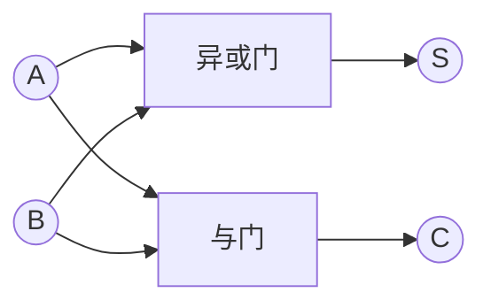
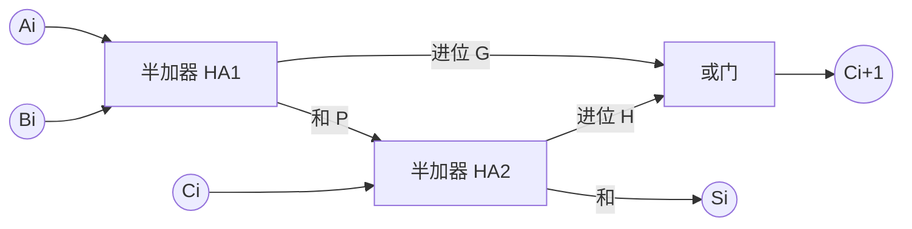
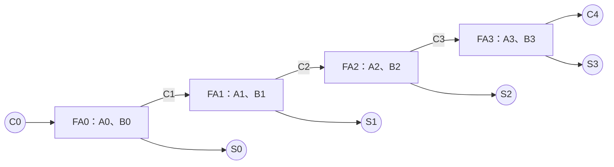

---
tags:
  - 数字逻辑
  - 组合逻辑电路
aliases:
  - 半加器
  - 全加器
  - 超前进位加法器
---

> [[ATLAS/卷9 数字逻辑与数字系统设计/目录|课程目录]] · [[ATLAS/卷9 数字逻辑与数字系统设计/第3章 组合逻辑电路/目录|第3章目录]]

加法器用于二进制加法运算，基本单元分为**半加器**和**全加器**。多个一位全加器可以组成多位加法器。

> [!note] 符号约定
> 逻辑表达式中的 $+$ 表示或，连写表示与，$\oplus$ 表示异或；数值等式中的 $+$ 表示算术加法。位编号从最低位 $0$ 开始，$C_i$ 是第 $i$ 位的输入进位，$C_{i+1}$ 是该位的输出进位。

# 1. 半加器

## 1.1 功能与真值表

半加器（HA）对两个一位二进制数 $A,B$ 求和，输出本位和 $S$ 与进位 $C$，**不考虑来自低位的进位**。

| $A$ | $B$ | $S$ | $C$ |
|:---:|:---:|:---:|:---:|
| 0 | 0 | 0 | 0 |
| 0 | 1 | 1 | 0 |
| 1 | 0 | 1 | 0 |
| 1 | 1 | 0 | 1 |

按数值解释，有 $A+B=2C+S$。例如 $1+1=(10)_2$，所以 $C=1,S=0$。

## 1.2 逻辑表达式与实现

$$
\boxed{S=\bar A B+A\bar B=A\oplus B},\qquad \boxed{C=AB}
$$

因此只需一个异或门和一个与门。

# 2. 全加器

## 2.1 功能与真值表

全加器（FA）把 $A_i,B_i$ 与低位进位 $C_i$ 相加，输出 $S_i,C_{i+1}$。按数值解释：

$$
A_i+B_i+C_i=2C_{i+1}+S_i
$$

| $A_i$ | $B_i$ | $C_i$ | $S_i$ | $C_{i+1}$ |
|:---:|:---:|:---:|:---:|:---:|
| 0 | 0 | 0 | 0 | 0 |
| 0 | 0 | 1 | 1 | 0 |
| 0 | 1 | 0 | 1 | 0 |
| 0 | 1 | 1 | 0 | 1 |
| 1 | 0 | 0 | 1 | 0 |
| 1 | 0 | 1 | 0 | 1 |
| 1 | 1 | 0 | 0 | 1 |
| 1 | 1 | 1 | 1 | 1 |

和位反映三个输入中1的奇偶性；至少两个输入为1时产生进位。

## 2.2 逻辑表达式

$$
\boxed{S_i=A_i\oplus B_i\oplus C_i}
$$

$$
\boxed{C_{i+1}=A_iB_i+A_iC_i+B_iC_i
=A_iB_i+(A_i\oplus B_i)C_i}
$$

按变量顺序 $A_i,B_i,C_i$，也可写为：

$$
S_i=\sum m(1,2,4,7),\qquad C_{i+1}=\sum m(3,5,6,7)
$$

后一种写法可以用 [[译码器]] 实现；保留异或关系的门电路实现见 [[异或门的逻辑实现]]。

## 2.3 用两个半加器构成全加器

第一个半加器计算 $P=A_i\oplus B_i$、$G=A_iB_i$；第二个计算 $S_i=P\oplus C_i$、$H=PC_i$；再令 $C_{i+1}=G+H$。

> [!tip] 半加器与全加器的区别
> 半加器没有输入进位端；全加器有。将全加器的 $C_i$ 固定为0，其功能就退化为半加器。

# 3. 多位加法器与进位方式

## 3.1 串行进位加法器

将第 $i$ 位全加器的 $C_{i+1}$ 接到下一位的进位输入，得到串行进位（逐位进位、脉动进位）加法器。

各位操作数同时送入，但最坏情况下进位要从最低位逐级传播。若每级进位延迟近似为 $t_c$，则最终进位的延迟约随 $nt_c$ 增长。

> [!warning] “串行进位”不等于“串行加法”
> 此处使用多个全加器并行接收操作数，只是进位逐级传播。每个时钟处理一位、复用一个全加器的串行加法器需要寄存器等存储元件，属于时序系统。

## 3.2 超前进位加法器

定义进位产生信号 $G_i$ 与进位传递信号 $P_i$：

$$
G_i=A_iB_i,\qquad P_i=A_i\oplus B_i
$$

于是：

$$
C_{i+1}=G_i+P_iC_i,\qquad S_i=P_i\oplus C_i
$$

- $G_i=1$：本位必产生进位，不依赖输入进位。
- $P_i=1$：本位将输入进位传给高位。
- $G_i=P_i=0$：本位不产生也不传递进位。

递推展开4位进位：

$$
\begin{aligned}
C_1&=G_0+P_0C_0\\
C_2&=G_1+P_1G_0+P_1P_0C_0\\
C_3&=G_2+P_2G_1+P_2P_1G_0+P_2P_1P_0C_0\\
C_4&=G_3+P_3G_2+P_3P_2G_1+P_3P_2P_1G_0+P_3P_2P_1P_0C_0
\end{aligned}
$$

这样可由各位 $P_i,G_i$ 和 $C_0$ 直接生成进位，减少逐位等待。代价是逻辑更复杂、门的输入数增加；位数较大时通常采用分组、分层结构。

> [!note] 不同教材的传递信号定义
> 有的教材取 $P_i=A_i+B_i$，也能满足 $C_{i+1}=G_i+P_iC_i$，但此时不能使用 $S_i=P_i\oplus C_i$。本文统一采用异或定义。

## 3.3 计算例题

求 $A=1011_2$、$B=0110_2$、$C_0=0$ 的和。

| 位 $i$（从低到高） | $A_i$ | $B_i$ | $C_i$ | $S_i$ | $C_{i+1}$ |
|:---:|:---:|:---:|:---:|:---:|:---:|
| 0 | 1 | 0 | 0 | 1 | 0 |
| 1 | 1 | 1 | 0 | 0 | 1 |
| 2 | 0 | 1 | 1 | 0 | 1 |
| 3 | 1 | 0 | 1 | 0 | 1 |

故 $C_4S_3S_2S_1S_0=10001_2$，即无符号数 $11+6=17$。

# 4. 用加法器实现减法

在 $n$ 位模 $2^n$ 运算下，$A-B\equiv A+\overline B+1\pmod{2^n}$，其中 $\overline B$ 为 $B$ 的逐位取反。

引入控制位 $M$，对每位 $B_i$ 接一个异或门：

$$
B_i'=B_i\oplus M,\qquad C_0=M
$$

| $M$ | 送入加法器的第二操作数 | $C_0$ | 功能 |
|:---:|---|:---:|---|
| 0 | $B$ | 0 | $A+B$ |
| 1 | $\overline B$ | 1 | $A-B$（保留低 $n$ 位） |

例如4位 $0101_2-0011_2$，计算 $0101+1100+1=10010$，低4位为 $0010$。

# 5. 进位与溢出

同一组二进制位可解释为无符号数或补码有符号数，两者的溢出判据不同。

| 运算解释 | 判据 |
|---|---|
| $n$ 位无符号加法 | $C_n=1$ 表示结果超出 $n$ 位范围 |
| 用 $A+\overline B+1$ 实现无符号减法 | $C_n=1$ 表示无借位，$C_n=0$ 表示有借位 |
| $n$ 位补码加法 | $V=C_{n-1}\oplus C_n$；同号相加却得到异号结果时溢出 |

例如4位补码 $0111+0001=1000$，即 $7+1$ 超出了 $[-8,7]$；虽然 $C_4=0$，仍发生有符号溢出。相反，$1111+0001=1\,0000$ 表示 $-1+1=0$，虽然有最高位进位，却没有有符号溢出。

相关笔记：[[异或门的逻辑实现]]、[[最小项与最大项]]、[[译码器]]。
# 课件对照与补充

> 来源：[[ATLAS/卷9 数字逻辑与数字系统设计/第3章 组合逻辑电路/附件/第3章组合逻辑.pdf#page=32|课件 PDF 第32–48页]]。以下补充课件中的实现与应用。

## 课件符号与本笔记的对应

课件全加器常用 $C_{i-1}$ 表示输入进位、$C_i$ 表示输出进位；本文采用 $C_i$ 输入、$C_{i+1}$ 输出。两者只是下标平移，阅读不同图时必须先确认定义。先行进位、超前进位、并行进位在本章指同类思路。

## 无反变量输入的与非门实现

半加器（第35页）：

$$N=\overline{AB},\quad U=\overline{AN},\quad V=\overline{BN},\quad S=\overline{UV},\quad C=\overline{NN}$$

使用5个二输入与非门，不必预先提供反变量。其中前4个门形成异或，最后1个门将 $N$ 取反得到进位。

全加器（第39页）可共享上述中间节点。先用4个与非门得到 $P=A\oplus B$ 并保留 $N=\overline{AB}$；再用4个与非门对 $P,C_{in}$ 求异或，保留其中 $Q=\overline{PC_{in}}$，最后：

$$S=P\oplus C_{in},\qquad C_{out}=\overline{NQ}=AB+PC_{in}$$

共9个二输入与非门。

## 集成并行加法器与应用

课件第45页介绍74283四位二进制加法器，第46页接常数0011实现BCD转余3码，第47–48页利用异或门和进位输入实现可控加减法。原有第4节已给出加减法通式。

第48页“一位BCD十进制加法器”需要检测大于9并加6修正，完整推导见 [[组合逻辑电路综合练习#6. 一位十进制BCD加法器（第48页）|BCD加法器解析]]。直接把二进制结果当成BCD结果会在10～19出错。

课件把74181与加法部件并列；应区别它是具多种算术与逻辑功能的ALU，不能按74283的单一加法器接口直接替换。

相关作业：[[第6次作业#1.3 全减器|全减器的与非门与或非门实现]]、[[第6次作业#3. 三个车间的发电机组控制|全加器用于机组控制]]、[[第6次作业#5. 用74283设计带进位的一位十进制BCD加法器|两片74283的BCD加法器接线与进位判别]]。
