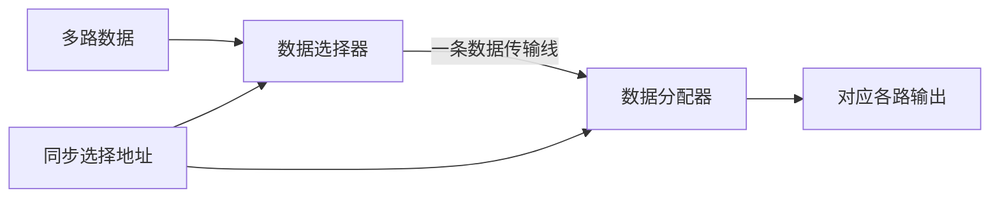

---
tags:
  - 数字逻辑
  - 组合逻辑电路
aliases:
  - 数据分配器
---

> [[ATLAS/卷9 数字逻辑与数字系统设计/目录|课程目录]] · [[ATLAS/卷9 数字逻辑与数字系统设计/第3章 组合逻辑电路/目录|第3章目录]]
> 来源：[[ATLAS/卷9 数字逻辑与数字系统设计/第3章 组合逻辑电路/附件/第3章组合逻辑.pdf#page=70|课件 PDF 第70–72页]]。页码按 PDF 阅读器计；推导和练习答案含补充解析。

# 1. 基本原理

数据分配器（DeMUX）在 $n$ 位选择信号控制下，把一路输入数据送到 $2^n$ 路输出中的某一路。对于高有效输出：

$$Y_i=Dm_i(S_{n-1},\ldots,S_0)$$

一分四：

$$Y_0=D\bar S_1\bar S_0,\quad Y_1=D\bar S_1S_0,\quad Y_2=DS_1\bar S_0,\quad Y_3=DS_1S_0$$

选中一路跟随 $D$，其余输出为0。$D=0$ 时所有输出可以同时为0，因此不能只凭某时刻的输出电平判断地址。

# 2. 74138作为一分八器件

74138输出低有效。设高有效使能脚电平为 $g_1$，两个低有效使能脚电平为 $g_{2A},g_{2B}$：

$$L_i=\overline{g_1\bar g_{2A}\bar g_{2B}m_i}$$

课件第71页把数据接到低有效使能端：令 $g_1=1,g_{2A}=0,g_{2B}=D$，则：

$$L_i=\overline{\bar Dm_i}=D+\bar m_i$$

| 地址状态 | 输出 |
|---|---|
| 第 $i$ 路被选中，$m_i=1$ | $L_i=D$，跟随数据 |
| 第 $i$ 路未选中，$m_i=0$ | $L_i=1$ |

若改把 $D$ 接高有效使能端，两个低有效使能端接0，则选中一路输出 $\bar D$，未选中仍为1。两种接法的数据极性不同。

# 3. 分时传输

发送端与接收端用一致的地址，依次接通同一路，实现多路信号分时共用传输线。

> [!note] 组合器件不自动保存数据
> 分配器只负责当前选中通道。若各接收端需要在未选中时继续保持上次值，要另加[[门控锁存器与状态预置|锁存器]]或寄存器；地址同步与传输延迟也需要系统保证。

# 4. 与其他器件对照

| 器件 | 数据方向 | 作用 |
|---|---|---|
| 数据选择器 | 多路 → 一路 | 选择某路数据 |
| 数据分配器 | 一路 → 多路中的一路 | 分配当前数据 |
| 二进制译码器 | 代码 → 一路有效信号 | 识别地址；使能端可用于数据分配 |

相关笔记：[[数据选择器]]、[[译码器]]。
