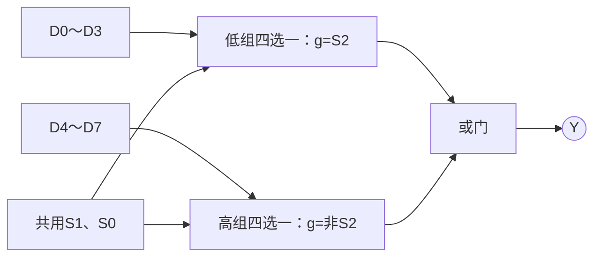

---
tags:
  - 数字逻辑
  - 组合逻辑电路
aliases:
  - 数据选择器
---

> [[ATLAS/卷9 数字逻辑与数字系统设计/目录|课程目录]] · [[ATLAS/卷9 数字逻辑与数字系统设计/第3章 组合逻辑电路/目录|第3章目录]]
> 来源：[[ATLAS/卷9 数字逻辑与数字系统设计/第3章 组合逻辑电路/附件/第3章组合逻辑.pdf#page=61|课件 PDF 第61–68页]]。页码按 PDF 阅读器计；推导和练习答案含补充解析。

# 1. 基本功能

数据选择器（MUX）在 $n$ 位选择信号控制下，将 $2^n$ 路数据中的一路送到输出。选择输入决定“选哪路”，数据输入决定“输出什么”。

二选一：$Y=\bar SD_0+SD_1$。

四选一，选择位按 $S_1S_0$ 从高到低排列：

$$Y=\bar S_1\bar S_0D_0+\bar S_1S_0D_1+S_1\bar S_0D_2+S_1S_0D_3=\sum_{i=0}^3m_iD_i$$

| $S_1S_0$ | 00 | 01 | 10 | 11 |
|---|---|---|---|---|
| $Y$ | $D_0$ | $D_1$ | $D_2$ | $D_3$ |

# 2. 双四选一74153

一片含两个四选一选择器，共用两位选择输入，每组有独立的低有效使能端。以 $g$ 表示使能引脚实际电平：

$$Y=\bar g\sum_{i=0}^3m_iD_i$$

- $g=0$：输出被选中的数据。
- $g=1$：输出固定为0，不是高阻态。
- 两组可以同时选通，但不能使用不同的选择地址。

课件将选择端命名为 $B,A$，其中 $B$ 为高位；数据端写作 $C_0\sim C_3$。本文用 $S_1,S_0$ 和 $D_0\sim D_3$，以免与函数变量混淆。

# 3. 用选择器实现函数

选择器对应按选择变量展开的布尔函数：将部分变量接地址端，其余变量决定各数据端接0、1、某变量或其反变量。

步骤：选择地址变量 → 按地址分组列剩余变量的子真值表 → 确定各 $D_i$ → 核对使能和极性。

## 3.1 课件例题：$F(A,B,C)=\sum m(1,3,5,6)$

取函数变量 $B,C$ 为高、低地址位，即 $S_1=B,S_0=C$。

| 地址 $BC$ | $A=0$ 时 $F$ | $A=1$ 时 $F$ | 数据端 |
|---|---|---|---|
| 00 | 0 | 0 | $D_0=0$ |
| 01 | 1 | 1 | $D_1=1$ |
| 10 | 0 | 1 | $D_2=A$ |
| 11 | 1 | 0 | $D_3=\bar A$ |

$$F=0\cdot m_0(B,C)+1\cdot m_1(B,C)+A m_2(B,C)+\bar A m_3(B,C)$$

用74153的一组，加一个反相器产生 $\bar A$，使能脚接0即可。芯片的低位地址端虽名为 $A$，这里接的是函数变量 $C$。

## 3.2 通用容量规律

- $2^n$ 选一器件可用 $n$ 个地址变量和常数数据端实现任意 $n$ 变量函数。
- 若允许数据端接一个剩余变量或其反变量，则可实现任意 $n+1$ 变量函数。
- 剩余变量更多时，每个数据端可能需要额外组合逻辑。

# 4. 用一片74153扩展为八选一（第67页）

两组共用 $S_1,S_0$；低组接 $D_0\sim D_3$，高组接 $D_4\sim D_7$。

令最高选择位为 $S_2$：低组使能引脚接 $S_2$，高组使能引脚接 $\bar S_2$，将两组输出经或门合成。

$$Y=Y_{\text{低组}}+Y_{\text{高组}}$$

由于禁用组输出0，或门不会改变启用组的数据。需要一个反相器和一个或门，输出不能直接并接。

# 5. 八选一74151（第68页）

有3位地址、8路数据输入、低有效使能以及互补输出。按课件的正相输出 $Y$ 和反相输出 $\bar Y$ 约定：使能时分别输出所选 $D_i$ 及 $\bar D_i$；禁用时分别为0和1。阅读符号时要确认使用的是哪一个输出。

相关笔记：[[译码器]]、[[数据分配器]]。
