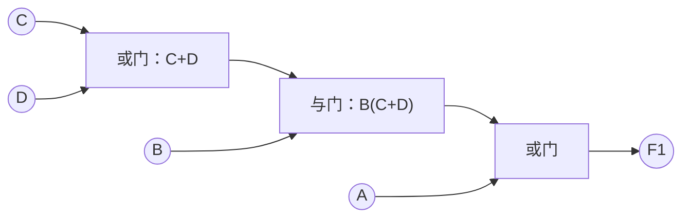
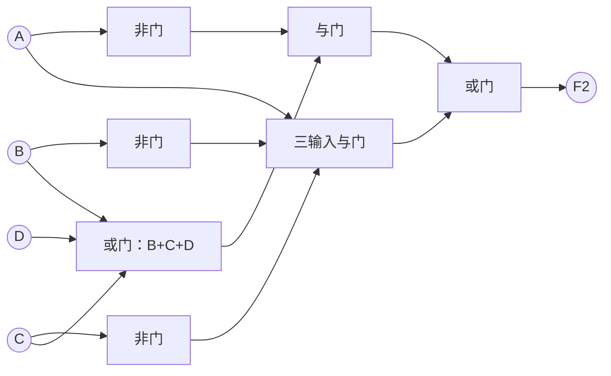
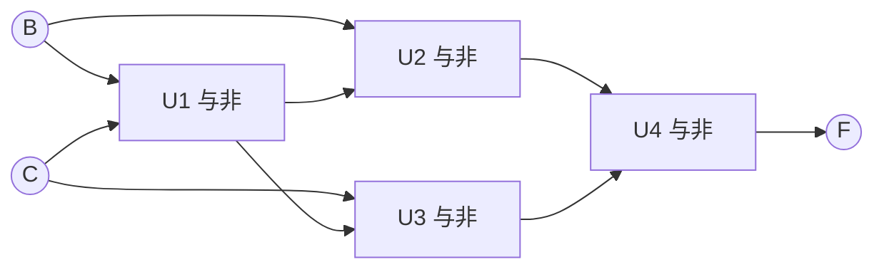
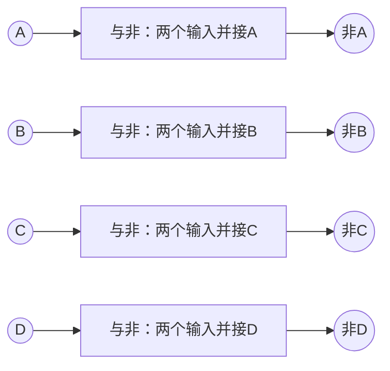
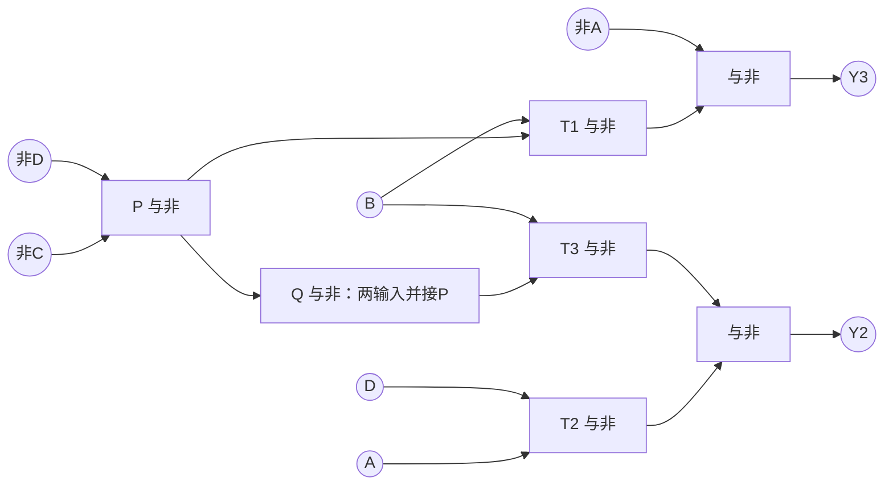
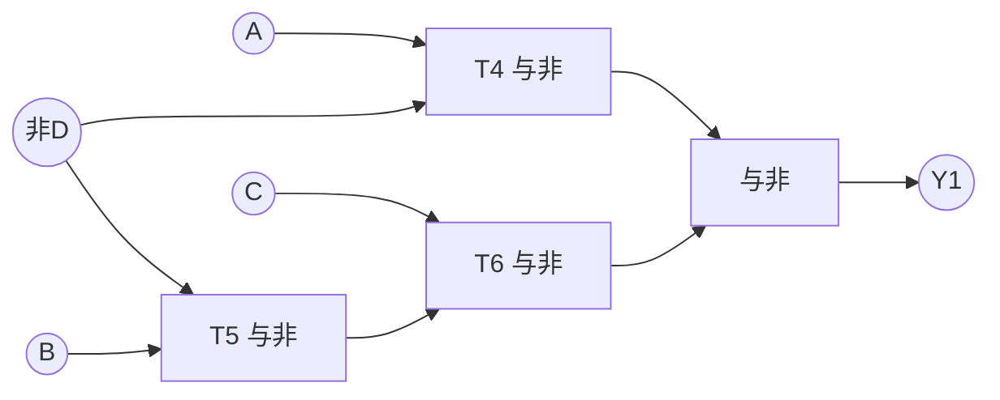
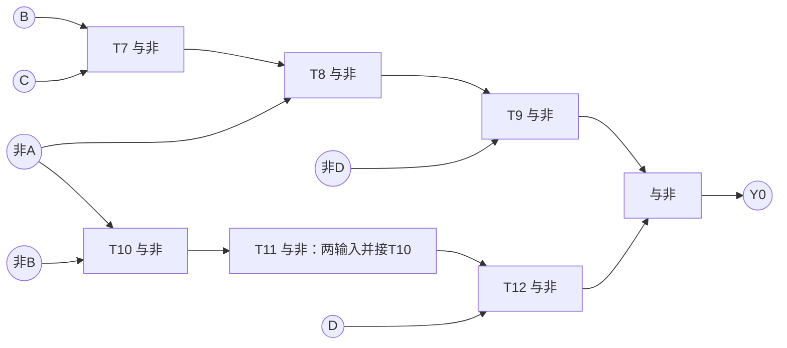
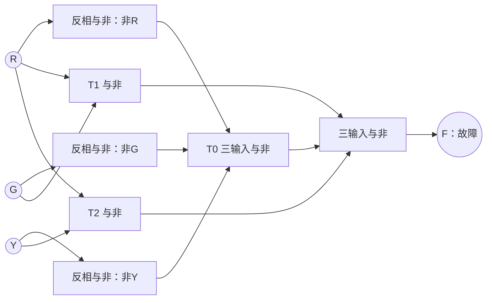
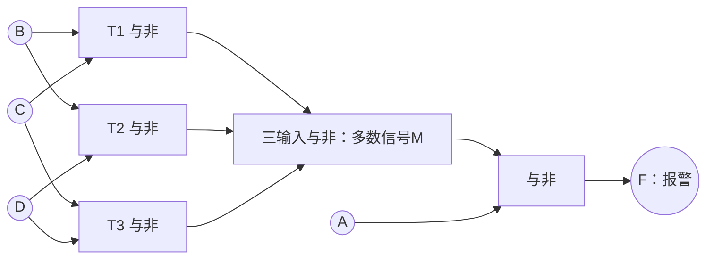

---
tags:
  - 数字逻辑
  - 组合逻辑电路
  - 作业
aliases:
  - 第5次作业组合逻辑设计
---

> [[ATLAS/卷9 数字逻辑与数字系统设计/目录|课程目录]] · [[ATLAS/卷9 数字逻辑与数字系统设计/第3章 组合逻辑电路/目录|第3章目录]]
> 题目来源：[[ATLAS/卷9 数字逻辑与数字系统设计/第3章 组合逻辑电路/附件/第5次作业组合逻辑设计.pdf#page=1|第5次作业原题（共1页、5题）]]。以下真值表、化简、解答和电路图为补充解析。

## 符号与画图约定

- 四位输入按 $ABCD$ 从高到低排列，权值为8、4、2、1。
- 逻辑式中 $+$ 表示或，连写表示与；数值关系中的加法为算术加法。
- $N(X,Y)=\overline{XY}$ 表示二输入与非门，$N(X,Y,Z)=\overline{XYZ}$ 表示三输入与非门。
- 反相也用与非门：$\bar X=N(X,X)$。图中“反相与非”表示同一信号接该门的两个输入。
- 第1题只要求判断条件，附与、或、非门实现；第2～5题严格使用与非门。第三题按要求先化为各级含双变量的与非式，仅用二输入与非门；第4、5题仍允许二输入和三输入与非门，接线表明确区分。
- 真值表中的 $d$ 是无关项，不是输出数据位 $D$。只能在题设排除的输入上使用。

# 1. 四位二进制数的区间判断

**题目：** $x=8A+4B+2C+D$，写出（1）$4<x\le15$；（2）$1\le x\le9$ 的判断条件。

设满足条件时 $F_1$、$F_2$ 分别为1，否则为0。

## 1.1 真值表

| $x$ | $ABCD$ | $F_1$ | $F_2$ |
|---:|:---:|:---:|:---:|
| 0 | 0000 | 0 | 0 |
| 1 | 0001 | 0 | 1 |
| 2 | 0010 | 0 | 1 |
| 3 | 0011 | 0 | 1 |
| 4 | 0100 | 0 | 1 |
| 5 | 0101 | 1 | 1 |
| 6 | 0110 | 1 | 1 |
| 7 | 0111 | 1 | 1 |
| 8 | 1000 | 1 | 1 |
| 9 | 1001 | 1 | 1 |
| 10 | 1010 | 1 | 0 |
| 11 | 1011 | 1 | 0 |
| 12 | 1100 | 1 | 0 |
| 13 | 1101 | 1 | 0 |
| 14 | 1110 | 1 | 0 |
| 15 | 1111 | 1 | 0 |

## 1.2 化简与答案

对于 $F_1$，$A=1$ 覆盖8～15；$B=1$ 且 $C+D=1$ 覆盖低半区的5～7：

$$\boxed{F_1=A+BC+BD=A+B(C+D)}$$

对于 $F_2$，用 $\bar A(B+C+D)$ 覆盖1～7，用 $A\bar B\bar C$ 覆盖8、9。通过卡诺图选择以下覆盖：

$$\boxed{F_2=\bar AB+\bar AC+\bar AD+A\bar B\bar C}$$

也可直接按区间分解，得到更便于解释的等价式：

$$\boxed{F_2=\bar A(B+C+D)+A\bar B\bar C}$$

前者是一个最简与或式，后者与之等价，适合按“1～7或8～9”两部分画图。

## 1.3 电路图

边界检查：$x=4,5$ 时 $F_1=0,1$；$x=0,1,9,10$ 时 $F_2=0,1,1,0$。

# 2. 余3码的范围判断：与非门实现

**题目：** 输入 $ABCD$ 为余3码，$x=8A+4B+2C+D-3$，$0\le x\le9$。当 $x\le2$ 或 $x\ge7$ 时，输出 $F=1$，用与非门设计。

## 2.1 真值表与无关项

合法输入码值是3～12，而不是0～9。

| 输入码值 | $ABCD$ | 十进制 $x$ | $F$ |
|---:|:---:|---:|:---:|
| 0～2 | 0000～0010 | 非法余3码 | $d$ |
| 3 | 0011 | 0 | 1 |
| 4 | 0100 | 1 | 1 |
| 5 | 0101 | 2 | 1 |
| 6 | 0110 | 3 | 0 |
| 7 | 0111 | 4 | 0 |
| 8 | 1000 | 5 | 0 |
| 9 | 1001 | 6 | 0 |
| 10 | 1010 | 7 | 1 |
| 11 | 1011 | 8 | 1 |
| 12 | 1100 | 9 | 1 |
| 13～15 | 1101～1111 | 非法余3码 | $d$ |

$$F=\sum m(3,4,5,10,11,12),\qquad d=\sum m(0,1,2,13,14,15)$$

## 2.2 卡诺图化简

列为 $AB$，行为 $CD$，均按格雷码排列：

| $CD\backslash AB$ | 00 | 01 | 11 | 10 |
|:---:|:---:|:---:|:---:|:---:|
| 00 | $d$ | 1 | 1 | 0 |
| 01 | $d$ | 1 | $d$ | 0 |
| 11 | 1 | 0 | $d$ | 1 |
| 10 | $d$ | 0 | $d$ | 1 |

用无关项将 $m_3,m_{10},m_{11}$ 合成 $\bar BC$，将 $m_4,m_5,m_{12}$ 合成 $B\bar C$：

$$\boxed{F=\bar BC+B\bar C=B\oplus C}$$

$A,D$ 在化简后不再参与输出。这只保证题目规定的合法余3码范围内满足要求，不承担非法码检测功能。

## 2.3 四个与非门实现

不直接使用异或门，也不需要额外反变量输入：

$$T=N(B,C),\quad U=N(B,T),\quad V=N(C,T),\quad F=N(U,V)$$

验证：$U=\bar B+C$，$V=\bar C+B$，故 $\overline{UV}=B\bar C+\bar BC$。

# 3. 四位分段代码转换：与非门实现

**题目：** 输入 $x$、输出 $y$ 均为四位二进制数；当 $0\le x\le4$ 时 $y=x$，当 $5\le x\le9$ 时 $y=x+3$，且 $x$ 不大于9。

定义输入 $x=(ABCD)_2$，输出 $y=(Y_3Y_2Y_1Y_0)_2$。这是分段转换，不能对全部输入一律加3。

## 3.1 真值表

| $x$ | $ABCD$ | $y$ | $Y_3Y_2Y_1Y_0$ |
|---:|:---:|---:|:---:|
| 0 | 0000 | 0 | 0000 |
| 1 | 0001 | 1 | 0001 |
| 2 | 0010 | 2 | 0010 |
| 3 | 0011 | 3 | 0011 |
| 4 | 0100 | 4 | 0100 |
| 5 | 0101 | 8 | 1000 |
| 6 | 0110 | 9 | 1001 |
| 7 | 0111 | 10 | 1010 |
| 8 | 1000 | 11 | 1011 |
| 9 | 1001 | 12 | 1100 |
| 10～15 | 1010～1111 | 不会出现 | $dddd$ |

每个输出都有同一组无关项 $d=\sum m(10,11,12,13,14,15)$。

## 3.2 分别化简四个输出

| 输出 | 值为1的最小项 | 卡诺图覆盖（包含可用无关项） |
|---|---|---|
| $Y_3$ | 5、6、7、8、9 | $A$；$BC$；$BD$ |
| $Y_2$ | 4、9 | $AD$；$B\bar C\bar D$ |
| $Y_1$ | 2、3、7、8 | $A\bar D$；$\bar BC$；$CD$ |
| $Y_0$ | 1、3、6、8 | $\bar A\bar BD$；$A\bar D$；$BC\bar D$ |

$$\boxed{\begin{aligned}
Y_3&=A+BC+BD,\\
Y_2&=AD+B\bar C\bar D,\\
Y_1&=A\bar D+\bar BC+CD,\\
Y_0&=\bar A\bar BD+A\bar D+BC\bar D.
\end{aligned}}$$

例如 $Y_0$ 中的 $\bar A\bar BD$ 覆盖输入1、3；$A\bar D$ 覆盖8并利用10、12、14为无关项；$BC\bar D$ 覆盖6并利用14。

## 3.3 先化为各级均含双变量的与非式

本题按**只用二输入与非门**设计。不能直接把三文字积项或三个积项之和接到三输入门；应先提取公因子、分组，再用德·摩根定理变换。

这里“双变量”指每个与非运算只有两个输入信号，输入可以是原变量、反变量或已经生成的中间信号。反相时将同一信号接到两个输入端。

### （1）$Y_3$：先合并 $BC+BD$

$$
\begin{aligned}
Y_3&=A+B(C+D)\\
&=\overline{\bar A\cdot\overline{B(C+D)}}.
\end{aligned}
$$

先令 $P=C+D=\overline{\bar C\cdot\bar D}$，于是：

$$\boxed{P=\overline{\bar C\cdot\bar D},\quad T_1=\overline{B\cdot P},\quad Y_3=\overline{\bar A\cdot T_1}}$$

### （2）$Y_2$：先将 $\bar C\bar D$ 作为中间信号

$$
\begin{aligned}
Y_2&=AD+B(\bar C\bar D)\\
&=\overline{\overline{AD}\cdot\overline{B(\bar C\bar D)}}.
\end{aligned}
$$

利用上一输出已生成的 $P=C+D$，得到 $Q=\bar C\bar D=\bar P$：

$$\boxed{Q=\overline{P\cdot P},\quad T_2=\overline{A\cdot D},\quad T_3=\overline{B\cdot Q},\quad Y_2=\overline{T_2\cdot T_3}}$$

### （3）$Y_1$：先合并 $\bar BC+CD$

$$
\begin{aligned}
Y_1&=A\bar D+C(\bar B+D)\\
&=\overline{\overline{A\bar D}\cdot\overline{C(\bar B+D)}}.
\end{aligned}
$$

其中 $\bar B+D=\overline{B\bar D}$，故：

$$\boxed{T_4=\overline{A\cdot\bar D},\quad T_5=\overline{B\cdot\bar D},\quad T_6=\overline{C\cdot T_5},\quad Y_1=\overline{T_4\cdot T_6}}$$

### （4）$Y_0$：按 $D$ 和 $\bar D$ 分组

$$
\begin{aligned}
Y_0&=(A+BC)\bar D+(\bar A\bar B)D\\
&=\overline{\overline{(A+BC)\bar D}\cdot\overline{(\bar A\bar B)D}}.
\end{aligned}
$$

将两个括号中的函数也变成二输入与非式：

$$
\boxed{\begin{aligned}
T_7&=\overline{B\cdot C},&T_8&=\overline{\bar A\cdot T_7}=A+BC,\\
T_9&=\overline{T_8\cdot\bar D},\\
T_{10}&=\overline{\bar A\cdot\bar B},&T_{11}&=\overline{T_{10}\cdot T_{10}}=\bar A\bar B,\\
T_{12}&=\overline{T_{11}\cdot D},&Y_0&=\overline{T_9\cdot T_{12}}.
\end{aligned}}
$$

至此，所有方框内的与非运算都只有两个因子，不再含需要三输入与非门直接实现的运算。

## 3.4 根据双变量与非式列接线表

先用4个二输入与非门产生反变量：$\bar A=N(A,A)$、$\bar B=N(B,B)$、$\bar C=N(C,C)$、$\bar D=N(D,D)$。各输出共用这些反变量。

| 输出所属部分 | 节点 | 输入1 | 输入2 | 输出含义 |
|---|---|---|---|---|
| 共享 | $P$ | $\bar C$ | $\bar D$ | $C+D$ |
| $Y_3$ | $T_1$ | $B$ | $P$ | $\overline{B(C+D)}$ |
| $Y_3$ | $Y_3$ | $\bar A$ | $T_1$ | $A+B(C+D)$ |
| $Y_2$ | $Q$ | $P$ | $P$ | $\bar C\bar D$ |
| $Y_2$ | $T_2$ | $A$ | $D$ | $\overline{AD}$ |
| $Y_2$ | $T_3$ | $B$ | $Q$ | $\overline{B\bar C\bar D}$ |
| $Y_2$ | $Y_2$ | $T_2$ | $T_3$ | $AD+B\bar C\bar D$ |
| $Y_1$ | $T_4$ | $A$ | $\bar D$ | $\overline{A\bar D}$ |
| $Y_1$ | $T_5$ | $B$ | $\bar D$ | $\bar B+D$ |
| $Y_1$ | $T_6$ | $C$ | $T_5$ | $\overline{C(\bar B+D)}$ |
| $Y_1$ | $Y_1$ | $T_4$ | $T_6$ | $A\bar D+C(\bar B+D)$ |
| $Y_0$ | $T_7$ | $B$ | $C$ | $\overline{BC}$ |
| $Y_0$ | $T_8$ | $\bar A$ | $T_7$ | $A+BC$ |
| $Y_0$ | $T_9$ | $T_8$ | $\bar D$ | $\overline{(A+BC)\bar D}$ |
| $Y_0$ | $T_{10}$ | $\bar A$ | $\bar B$ | $\overline{\bar A\bar B}$ |
| $Y_0$ | $T_{11}$ | $T_{10}$ | $T_{10}$ | $\bar A\bar B$ |
| $Y_0$ | $T_{12}$ | $T_{11}$ | $D$ | $\overline{\bar A\bar BD}$ |
| $Y_0$ | $Y_0$ | $T_9$ | $T_{12}$ | $(A+BC)\bar D+(\bar A\bar B)D$ |

接线表18个门，加上4个反相门，共 **22个二输入与非门**。这是与上面分组推导逐项对应的实现，不宣称为所有多级实现中的最少门数。

## 3.5 按接线表画电路

所有矩形均为二输入与非门。图中的反变量由4个共享反相门提供；标注“输入并接”的门，其两个输入接同一信号。

### 反变量生成

### $Y_3$ 与 $Y_2$（共享 $P$）

### $Y_1$

### $Y_0$

关键边界：$x=4\to0100$，$x=5\to1000$；$x=8\to1011$，$x=9\to1100$。已核验上述二输入与非网络在全部10种合法输入下与题意一致，并在全部16种输入下与第3.2节的化简式等价。输入10～15的实际电平由电路决定，题目不要求它们为0。

# 4. 交通信号灯故障检测：与非门实现

**题目：** 正常情况只允许红灯、绿灯、黄灯或黄加绿灯点亮，其他情况报警。

设红、黄、绿灯状态为 $R,Y,G$，亮为1；故障输出 $F=1$，正常输出 $F=0$。

> [!warning] 本题与课件例题不同
> 本题允许黄、绿同时亮，$RYG=011$ 为正常状态。不能照抄“恰有一盏灯亮”的课件答案。

## 4.1 真值表

| $R$ | $Y$ | $G$ | 状态 | $F$ |
|:---:|:---:|:---:|---|:---:|
| 0 | 0 | 0 | 全灭，故障 | 1 |
| 0 | 0 | 1 | 绿灯，正常 | 0 |
| 0 | 1 | 0 | 黄灯，正常 | 0 |
| 0 | 1 | 1 | 黄加绿，正常 | 0 |
| 1 | 0 | 0 | 红灯，正常 | 0 |
| 1 | 0 | 1 | 红加绿，故障 | 1 |
| 1 | 1 | 0 | 红加黄，故障 | 1 |
| 1 | 1 | 1 | 三灯全亮，故障 | 1 |

## 4.2 化简

$$F=\sum m(0,5,6,7)=\boxed{\bar R\bar Y\bar G+RG+RY}$$

$m_0$ 单独检测全灭；$m_5,m_7$ 合并为 $RG$；$m_6,m_7$ 合并为 $RY$。本题没有无关项，所有8种输入都需判断。

## 4.3 与非门实现及电路图

$$\begin{aligned}
\bar R&=N(R,R),\quad\bar Y=N(Y,Y),\quad\bar G=N(G,G),\\
T_0&=N(\bar R,\bar Y,\bar G),\quad T_1=N(R,G),\quad T_2=N(R,Y),\\
F&=N(T_0,T_1,T_2).
\end{aligned}$$

共7个与非门，其中5个二输入门、2个三输入门。

# 5. 四传感器装置报警：与非门实现

**题目：** $A=1$，且 $B,C,D$ 中至少两个为1时，装置正常；否则报警。

设正常信号为 $H$，报警输出为 $F$，故 $F=\bar H$。

## 5.1 真值表

| $BCD$ | $B,C,D$ 中1的个数 | $A=0$ 时报警 $F$ | $A=1$ 时报警 $F$ |
|:---:|:---:|:---:|:---:|
| 000 | 0 | 1 | 1 |
| 001 | 1 | 1 | 1 |
| 010 | 1 | 1 | 1 |
| 011 | 2 | 1 | 0 |
| 100 | 1 | 1 | 1 |
| 101 | 2 | 1 | 0 |
| 110 | 2 | 1 | 0 |
| 111 | 3 | 1 | 0 |

该表按 $A$ 分成两列，覆盖全部16种输入。

## 5.2 推导

三个输入“至少两个为1”的多数函数为：

$$M=BC+BD+CD$$

正常条件和报警条件分别是：

$$H=A(BC+BD+CD)$$

$$\boxed{F=\overline{A(BC+BD+CD)}}$$

将报警函数展开也可得到：

$$F=\bar A+\bar B\bar C+\bar B\bar D+\bar C\bar D$$

后一式的含义是：$A=0$，或其余三个传感器中至少两个为0时报警。实现时保留正常条件的因式分解形式，可减少反相和门数。

## 5.3 五个与非门实现

$$T_1=N(B,C),\quad T_2=N(B,D),\quad T_3=N(C,D)$$

$$M=N(T_1,T_2,T_3),\qquad F=N(A,M)$$

共5个与非门：4个二输入门、1个三输入门。

验证：$A=0$ 时无论其他输入怎样都报警；$ABCD=1011,1101,1110,1111$ 时不报警；$ABCD=1001$ 时仅一个辅助传感器为1，仍需报警。

## 答案速查

| 题号 | 核心结果 |
|---|---|
| 1（1） | $F_1=A+B(C+D)$ |
| 1（2） | $F_2=\bar A(B+C+D)+A\bar B\bar C$ |
| 2 | $F=\bar BC+B\bar C$，用4个与非门实现 |
| 3 | 四个输出表达式与共享门接线见第3节 |
| 4 | $F=\bar R\bar Y\bar G+RG+RY$ |
| 5 | $F=\overline{A(BC+BD+CD)}$ |

## 核验说明

已对第1题全部16种输入、第2题10种合法余3码、第3题10种合法输入、第4题全部8种灯态、第5题全部16种输入逐一验证；第2～5题还按接线表验证了与非门网络与目标输出一致。第2、3题的非法输入仅作无关项处理。

相关笔记：[[组合逻辑电路的设计]]、[[布尔函数的卡诺图化简]]、[[完全确定与不完全确定布尔函数]]、[[与非门与或非门的逻辑实现]]。
