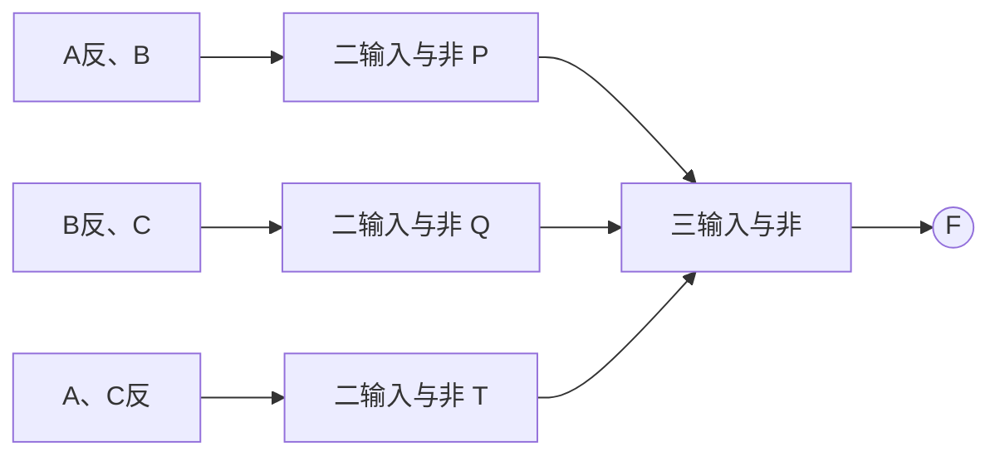
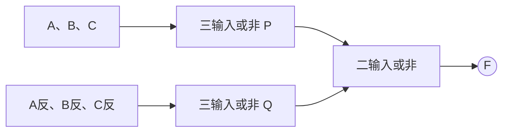
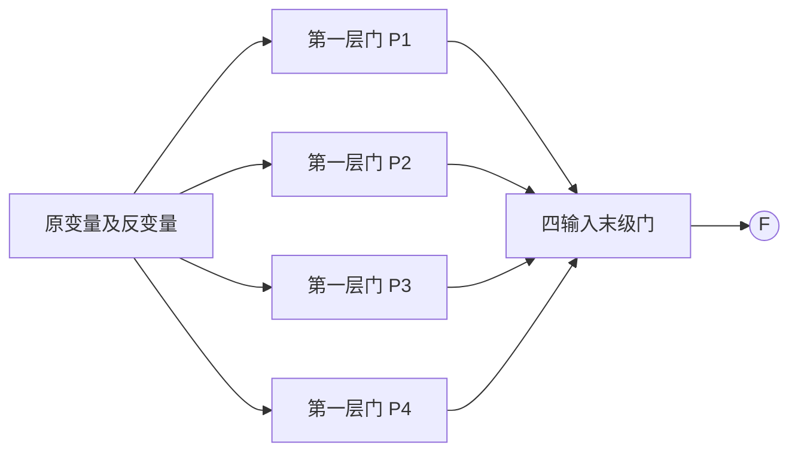
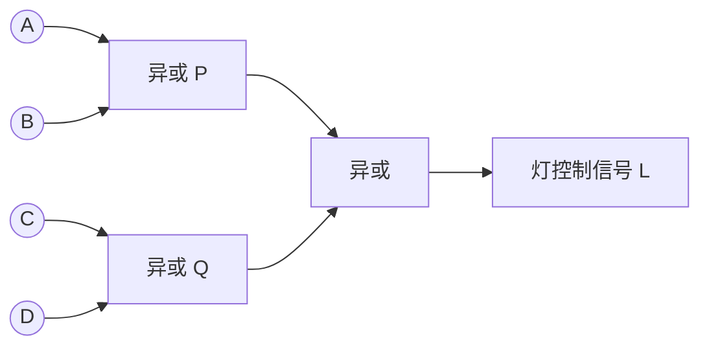
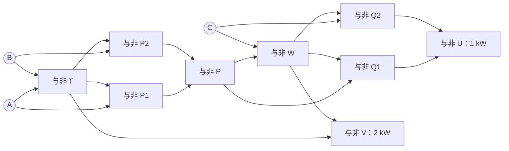
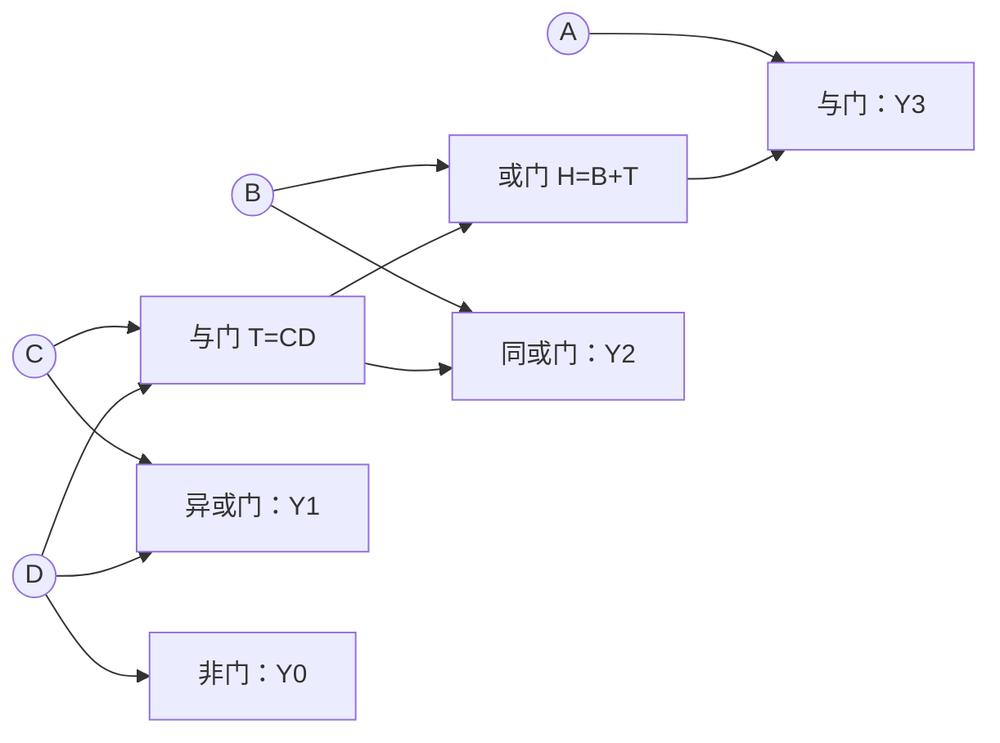
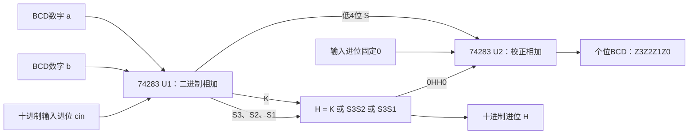

---
tags:
  - 数字逻辑
  - 组合逻辑电路
  - 作业
aliases:
  - 第6次作业组合逻辑设计
  - 全减器
---

# 1. 分别用与非门、或非门设计三类电路

## 1.1 三变量非一致电路

**题目：** 分别用与非门、或非门设计三变量非一致电路。

定义：输入 $A,B,C$ **不全相同**时 $F=1$；全0、全1时 $F=0$。

### 真值表与化简

| $A$ | $B$ | $C$ | $F$ |
|:---:|:---:|:---:|:---:|
| 0 | 0 | 0 | 0 |
| 0 | 0 | 1 | 1 |
| 0 | 1 | 0 | 1 |
| 0 | 1 | 1 | 1 |
| 1 | 0 | 0 | 1 |
| 1 | 0 | 1 | 1 |
| 1 | 1 | 0 | 1 |
| 1 | 1 | 1 | 0 |

$$
F=\sum m(1,2,3,4,5,6)
$$

卡诺图可将 $(2,3)$、$(1,5)$、$(4,6)$ 分别合并，得到与或式：

$$\boxed{F=\bar AB+\bar BC+A\bar C}$$

也可直接按“至少一个1，而且至少一个0”写出或与式：

$$\boxed{F=(A+B+C)(\bar A+\bar B+\bar C)}$$

### 与非门方案

$$F=\overline{\overline{\bar AB}\;\overline{\bar BC}\;\overline{A\bar C}}$$

| 门输出 | 接线 |
|---|---|
| $\bar A,\bar B,\bar C$ | 分别用 $N(A,A),N(B,B),N(C,C)$ |
| $P$ | $N(\bar A,B)$ |
| $Q$ | $N(\bar B,C)$ |
| $T$ | $N(A,\bar C)$ |
| $F$ | $N(P,Q,T)$ |

共7个与非门（包括3个反相用门）。

图中反变量均按接线表由与非门生成。

### 或非门方案

$$F=\overline{\overline{A+B+C}+\overline{\bar A+\bar B+\bar C}}$$

| 门输出 | 接线 |
|---|---|
| $\bar A,\bar B,\bar C$ | 分别用 $R(A,A),R(B,B),R(C,C)$ |
| $P$ | $R(A,B,C)$ |
| $Q$ | $R(\bar A,\bar B,\bar C)$ |
| $F$ | $R(P,Q)$ |

共6个或非门。

图中反变量均由或非门生成。更多功能分析见 [[组合逻辑电路分析#2. 三变量非一致电路（第27–28页）|非一致电路]]。

## 1.2 三变量偶数电路

**题目：** 分别用与非门、或非门设计三变量偶数电路。

“偶数”指**输入中1的个数为偶数**，包括0个1，不是把 $ABC$ 解释成二进制整数后判断奇偶。

### 真值表与表达式

| $ABC$ | 1的个数 | $F$ |
|:---:|:---:|:---:|
| 000 | 0 | 1 |
| 001 | 1 | 0 |
| 010 | 1 | 0 |
| 011 | 2 | 1 |
| 100 | 1 | 0 |
| 101 | 2 | 1 |
| 110 | 2 | 1 |
| 111 | 3 | 0 |

$$
\boxed{F=\overline{A\oplus B\oplus C}}
=\sum m(0,3,5,6)=\prod M(1,2,4,7)
$$

其卡诺图中1格互不相邻，0格也互不相邻，二级与或式/或与式不能通过合并相邻格减少项数。

$$F=\bar A\bar B\bar C+\bar ABC+A\bar BC+AB\bar C$$

$$F=(A+B+\bar C)(A+\bar B+C)(\bar A+B+C)(\bar A+\bar B+\bar C)$$

### 两种纯门电路接线

先分别用所要求的门生成 $\bar A,\bar B,\bar C$，再按下表连接：

| 中间信号 | 与非门方案 | 或非门方案 |
|---|---|---|
| $P_1$ | $N(\bar A,\bar B,\bar C)$ | $R(A,B,\bar C)$ |
| $P_2$ | $N(\bar A,B,C)$ | $R(A,\bar B,C)$ |
| $P_3$ | $N(A,\bar B,C)$ | $R(\bar A,B,C)$ |
| $P_4$ | $N(A,B,\bar C)$ | $R(\bar A,\bar B,\bar C)$ |
| $F$ | $N(P_1,P_2,P_3,P_4)$ | $R(P_1,P_2,P_3,P_4)$ |

每种方案都是3个反相用门、4个三输入门、1个四输入门，共8个门。两列是独立方案，不混接。

图中每个门的类型和输入均按所选接线表列确定。异或表达式只用于识别功能，最终方案未直接使用异或门。

## 1.3 全减器

**题目：** 分别用与非门、或非门设计全减器。

设 $A$ 为被减数位，$B$ 为减数位，$C$ 为**来自低位的借位输入**；$D$ 为本位差，$Q$ 为向高位的借位输出。按数值解释：

$$\boxed{A-B-C=D-2Q}$$

### 真值表

| $A$ | $B$ | $C$ | $A-B-C$ | 差 $D$ | 借位 $Q$ |
|:---:|:---:|:---:|:---:|:---:|:---:|
| 0 | 0 | 0 | 0 | 0 | 0 |
| 0 | 0 | 1 | -1 | 1 | 1 |
| 0 | 1 | 0 | -1 | 1 | 1 |
| 0 | 1 | 1 | -2 | 0 | 1 |
| 1 | 0 | 0 | 1 | 1 | 0 |
| 1 | 0 | 1 | 0 | 0 | 0 |
| 1 | 1 | 0 | 0 | 0 | 0 |
| 1 | 1 | 1 | -1 | 1 | 1 |

差位仍为奇数函数：

$$\boxed{D=A\oplus B\oplus C}=\sum m(1,2,4,7)$$

若 $A=0$，$B,C$ 至少一个为1就需要借位；若 $A=1$，只有 $B=C=1$ 才需要借位。因此：

$$
\boxed{Q=\bar AB+\bar AC+BC}
=\sum m(1,2,3,7)
$$

利用多数函数的等价形式，还可得：

$$\boxed{Q=(\bar A+B)(\bar A+C)(B+C)}$$

差位的与或式、或与式分别为：

$$D=\bar A\bar BC+\bar AB\bar C+A\bar B\bar C+ABC$$

$$D=(A+B+C)(A+\bar B+\bar C)(\bar A+B+\bar C)(\bar A+\bar B+C)$$

### 与非门实现

先用3个与非门得到 $\bar A,\bar B,\bar C$，两个输出共享这些反变量。

| 输出 | 第一层与非门 | 末级与非门 |
|---|---|---|
| $D$ | $P_1=N(\bar A,\bar B,C)$；$P_2=N(\bar A,B,\bar C)$；$P_3=N(A,\bar B,\bar C)$；$P_4=N(A,B,C)$ | $D=N(P_1,P_2,P_3,P_4)$ |
| $Q$ | $T_1=N(\bar A,B)$；$T_2=N(\bar A,C)$；$T_3=N(B,C)$ | $Q=N(T_1,T_2,T_3)$ |

此直接二级实现共12个与非门，包括3个共享反相用门。

### 或非门实现

先用3个或非门得到 $\bar A,\bar B,\bar C$。

| 输出 | 第一层或非门 | 末级或非门 |
|---|---|---|
| $D$ | $P_1=R(A,B,C)$；$P_2=R(A,\bar B,\bar C)$；$P_3=R(\bar A,B,\bar C)$；$P_4=R(\bar A,\bar B,C)$ | $D=R(P_1,P_2,P_3,P_4)$ |
| $Q$ | $T_1=R(\bar A,B)$；$T_2=R(\bar A,C)$；$T_3=R(B,C)$ | $Q=R(T_1,T_2,T_3)$ |

此直接二级实现共12个或非门。上述门数用于说明具体方案，不声称所有多级实现都需要这么多门。

> [!warning] 全减器与全加器不能照搬借位式
> 两者的差位/和位均为 $A\oplus B\oplus C$，但全加器进位为 $AB+AC+BC$，全减器借位为 $\bar AB+\bar AC+BC$。例如输入001时，全减器需要借位，全加器不产生进位。

# 2. 用异或门实现四地独立控灯

**题目：** 用异或门设计一个在四个不同地方均可独立控制路灯亮灭的电路。

把四个开关位置定义为 $A,B,C,D\in\{0,1\}$，灯亮为 $L=1$。任意一个开关翻转时，灯的状态都应翻转。

$$\boxed{L=A\oplus B\oplus C\oplus D}$$

例如仅翻转 $A$：

$$L'=\bar A\oplus B\oplus C\oplus D=L\oplus1=\bar L$$

其余三个开关同理。因此无需知道其他开关的位置，任何一地都能改变当前灯的亮灭。

使用3个二输入异或门，分成两级：

$$P=A\oplus B,\quad Q=C\oplus D,\quad L=P\oplus Q$$

| 开关中1的个数 | 0 | 1 | 2 | 3 | 4 |
|---|:---:|:---:|:---:|:---:|:---:|
| $L$ | 0 | 1 | 0 | 1 | 0 |

本方案规定0000时灯灭。若要求0000时灯亮，改为 $L=1\oplus A\oplus B\oplus C\oplus D$ 即可。题目中的“独立控制”指**任意一个开关翻转可改变灯态**；若两个开关同时翻转，灯态不变，并不违背要求。此处输出是逻辑控制信号，实际灯负载由相应驱动级控制。

# 3. 三个车间的发电机组控制

**题目：** 三个车间各需1 kW，由一台1 kW机组和一台2 kW机组供电。根据开工情况启动机组，既满足供电又节省能源，列真值表并用与非门实现。

## 3.1 定义变量与调度规则

令 $A,B,C=1$ 表示相应车间开工；$U=1$ 启动1 kW机组，$V=1$ 启动2 kW机组。按题设离散容量模型选择恰好满足总需求的组合：

$$\boxed{U+2V=A+B+C}\qquad\text{（数值等式）}$$

| $A$ | $B$ | $C$ | 需求/kW | $U$（1 kW） | $V$（2 kW） |
|:---:|:---:|:---:|:---:|:---:|:---:|
| 0 | 0 | 0 | 0 | 0 | 0 |
| 0 | 0 | 1 | 1 | 1 | 0 |
| 0 | 1 | 0 | 1 | 1 | 0 |
| 0 | 1 | 1 | 2 | 0 | 1 |
| 1 | 0 | 0 | 1 | 1 | 0 |
| 1 | 0 | 1 | 2 | 0 | 1 |
| 1 | 1 | 0 | 2 | 0 | 1 |
| 1 | 1 | 1 | 3 | 1 | 1 |

## 3.2 输出表达式

1 kW机组在恰有1个或3个车间开工时启动，2 kW机组在至少2个车间开工时启动：

$$\boxed{U=A\oplus B\oplus C}$$

$$\boxed{V=AB+AC+BC=AB+(A\oplus B)C}$$

因此，这个控制器恰好实现一个 [[加法器|全加器]]：和位控制1 kW机组，进位控制2 kW机组。

## 3.3 仅用9个二输入与非门实现

为了满足题目要求，把两个异或模块也展开为与非门，并共享进位计算所需节点：

| 门 | 接线 | 作用 |
|---|---|---|
| 1 | $T=N(A,B)$ | $\overline{AB}$ |
| 2 | $P_1=N(A,T)$ | 第一级异或中间节点 |
| 3 | $P_2=N(B,T)$ | 第一级异或中间节点 |
| 4 | $P=N(P_1,P_2)$ | $A\oplus B$ |
| 5 | $W=N(P,C)$ | $\overline{PC}$ |
| 6 | $Q_1=N(P,W)$ | 第二级异或中间节点 |
| 7 | $Q_2=N(C,W)$ | 第二级异或中间节点 |
| 8 | $U=N(Q_1,Q_2)$ | $P\oplus C$ |
| 9 | $V=N(T,W)$ | $AB+PC$ |

检查：2个车间开工时只能启动2 kW机组；3个车间开工时两台都启动。不能把“至少一个车间开工”作为1 kW机组的启动条件，否则2个车间开工时会多开一台机组。

# 4. 余3码转换为8421 BCD

**题目：** 设计一个将余3码转换为8421 BCD的逻辑电路。

## 4.1 输入输出与真值表

设输入余3码为 $ABCD$，输出BCD为 $Y_3Y_2Y_1Y_0$，两者均按高位到低位书写。若对应的十进制数字为 $x$，则输入码值为 $x+3$，输出码值为 $x$。

| 十进制数字 $x$ | 输入 $ABCD$ | 输出 $Y_3Y_2Y_1Y_0$ |
|---:|:---:|:---:|
| 0 | 0011 | 0000 |
| 1 | 0100 | 0001 |
| 2 | 0101 | 0010 |
| 3 | 0110 | 0011 |
| 4 | 0111 | 0100 |
| 5 | 1000 | 0101 |
| 6 | 1001 | 0110 |
| 7 | 1010 | 0111 |
| 8 | 1011 | 1000 |
| 9 | 1100 | 1001 |

题设输入为余3码，因此合法码值是3～12；其余6种输入可作为无关项：

$$d=\sum m(0,1,2,13,14,15)$$

这些无关项只用于简化转换逻辑，不表示电路会识别非法输入或自动报错。

## 4.2 最小项与卡诺图合并

以下编号均按输入变量 $A,B,C,D$ 的顺序确定：

$$
\begin{aligned}
Y_3&=\sum m(11,12),\\
Y_2&=\sum m(7,8,9,10),\\
Y_1&=\sum m(5,6,9,10),\\
Y_0&=\sum m(4,6,8,10,12).
\end{aligned}
$$

借助无关项，可按下表合并。其中所列集合包括参与合并的无关项。

| 输出 | 合并的格子 | 对应积项 |
|---|---|---|
| $Y_3$ | $(12,13,14,15)$；$(11,15)$ | $AB$；$ACD$ |
| $Y_2$ | $(0,1,8,9)$；$(0,2,8,10)$；$(7,15)$ | $\bar B\bar C$；$\bar B\bar D$；$BCD$ |
| $Y_1$ | $(1,5,9,13)$；$(2,6,10,14)$ | $\bar CD$；$C\bar D$ |
| $Y_0$ | $(0,2,4,6,8,10,12,14)$ | $\bar D$ |

因此：

$$
\boxed{
\begin{aligned}
Y_3&=AB+ACD=A(B+CD),\\
Y_2&=\bar B\bar C+\bar B\bar D+BCD,\\
Y_1&=\bar CD+C\bar D=C\oplus D,\\
Y_0&=\bar D.
\end{aligned}}
$$

## 4.3 门电路实现

第4题未限制门类型，可以共享 $T=CD$，将 $Y_2$ 改写为：

$$Y_2=\bar B\overline{CD}+BCD=\bar B\bar T+BT=\overline{B\oplus T}$$

采用下面的连接即可完成转换：

| 信号 | 连接 |
|---|---|
| $T$ | $C,D$ 接二输入与门 |
| $H$ | $B,T$ 接二输入或门 |
| $Y_3$ | $A,H$ 接二输入与门 |
| $Y_2$ | $B,T$ 接同或门；也可先异或再取反 |
| $Y_1$ | $C,D$ 接异或门 |
| $Y_0$ | $D$ 接非门 |

检查边界：0011转换成0000；1011转换成1000；1100转换成1001。对非法输入不规定输出。

## 4.4 另一种实现：用74283减3

在4位模16运算中，减3等价于加13，即加1101：

$$x=(x+3)+13\pmod{16}$$

所以也可以将输入余3码与常数1101送入一片74283，输入进位置0，取低4位和作为BCD输出，舍去最高位进位。合法输入3～12加13后为16～25，低4位恰为0～9。

注意这是“余3码转BCD”；[[组合逻辑电路综合练习#1. 8421 BCD转余3码（第23、46页）|BCD转余3码]] 的方向相反，需要加0011。

# 5. 用74283设计带进位的一位十进制BCD加法器

**题目：** 用四位二进制并行加法器74283设计一个带进位的一位十进制8421 BCD码加法器。

## 5.1 功能与总体方案

输入是两个合法BCD数字 $a,b\in\{0,\ldots,9\}$ 和低十进制位传来的进位 $c_{\mathrm{in}}\in\{0,1\}$；输出为一位BCD数字 $Z_3Z_2Z_1Z_0$ 和向高十进制位的进位 $H$。

$$T=a+b+c_{\mathrm{in}}\in[0,19]$$

应满足：

$$\boxed{10H+(Z_3Z_2Z_1Z_0)_2=T}$$

采用**两片74283加校正判别逻辑**：第一片求二进制和，第二片按需要加6。题目中的“一位十进制”指一个BCD数位，并不限制只能使用一片芯片。

## 5.2 第一片：计算二进制和

令第一片输出进位为 $K$，低4位和为 $S_3S_2S_1S_0$，则：

$$T=16K+8S_3+4S_2+2S_1+S_0$$

- $T=0\sim9$：二进制低4位已经是正确的BCD。
- $T=10\sim15$：$K=0$，但低4位为非法BCD，需要加6。
- $T=16\sim19$：$K=1$，低4位虽然落在0～3，仍必须加6并输出十进制进位。

## 5.3 判别式与加6的原因

对于4位数 $S$，大于9意味着最高位 $S_3=1$，且 $S_2,S_1$ 至少一个为1；1000和1001不能判为大于9。因此：

$$\boxed{H=K+S_3S_2+S_3S_1=K+S_3(S_2+S_1)}$$

这里 $+$ 表示逻辑或。$H=1$ 当且仅当总和 $T\ge10$，同时作为校正控制和十进制进位。

为什么加6？二进制每16进一，十进制每10进一，两者相差6。对于 $10\le T\le19$：

$$T+6=16+(T-10)$$

所以把低4位加6并保留低4位，恰好得到十进制个位 $T-10$。

## 5.4 第二片：条件校正

第二片输入为 $S_3S_2S_1S_0$ 和 $0HH0$，输入进位固定为0：

$$\boxed{(Z_3Z_2Z_1Z_0)_2=(S+6H)\bmod16}$$

| $H$ | 第二片的校正操作数 | 含义 |
|:---:|:---:|---|
| 0 | 0000 | 不校正 |
| 1 | 0110 | 加6校正 |

## 5.5 74283信号接线表

芯片操作数端按低位到高位记为 $A_1\sim A_4,B_1\sim B_4$，和端为 $\Sigma_1\sim\Sigma_4$，输入/输出进位为 $C_0,C_4$。**下标1对应最低位，不是最高位；这些是信号名称，不是封装管脚编号。** 输入数字的位则记为 $a_3\sim a_0,b_3\sim b_0$。

| 芯片信号（按低位到高位） | 第一片U1 | 第二片U2 |
|---|---|---|
| $A_1,A_2,A_3,A_4$ | $a_0,a_1,a_2,a_3$ | $S_0,S_1,S_2,S_3$ |
| $B_1,B_2,B_3,B_4$ | $b_0,b_1,b_2,b_3$ | $0,H,H,0$ |
| $C_0$ | $c_{\mathrm{in}}$ | 0 |
| $\Sigma_1,\Sigma_2,\Sigma_3,\Sigma_4$ | $S_0,S_1,S_2,S_3$ | $Z_0,Z_1,Z_2,Z_3$ |
| $C_4$ | $K$，接校正判别逻辑 | 记为 $K'$，不作为单独的十进制进位 |

判别电路可用两个与门产生 $S_3S_2,S_3S_1$，再与 $K$ 接三输入或门；也可按因式分解式用一个或门、一个与门、一个或门实现。

## 5.6 十进制进位为什么不能只取第二片进位

| 总和 $T$ | 第一片 $K$ | 第一片低4位 $S$ | $H$ | 第二片 $S+6H$ | 第二片 $K'$ | 个位 |
|---:|:---:|:---:|:---:|:---:|:---:|---:|
| 9 | 0 | 1001 | 0 | 0 1001 | 0 | 9 |
| 10 | 0 | 1010 | 1 | 1 0000 | 1 | 0 |
| 15 | 0 | 1111 | 1 | 1 0101 | 1 | 5 |
| 16 | 1 | 0000 | 1 | 0 0110 | 0 | 6 |
| 19 | 1 | 0011 | 1 | 0 1001 | 0 | 9 |

对于16～19，第二片不产生进位，但十进制进位必须为1。因此正确输出是：

$$\boxed{C_{\mathrm{out,decimal}}=H}$$

在本题合法输入范围内，也有 $H=K+K'$（逻辑或），但直接使用校正判别信号 $H$ 更清楚。

例如 $9+9+1=19$：第一片输出 $K=1,S=0011$，判别 $H=1$；第二片计算 $0011+0110=1001$，最终输出“十位进位1、个位BCD为1001”，即十进制19。

若扩展为多位十进制加法器，应把本位的 $H$ 接到下一位**第一片**74283的 $C_0$；每一位用于校正的第二片 $C_0$ 都固定为0。

相关笔记：[[加法器]]、[[组合逻辑电路综合练习#6. 一位十进制BCD加法器（第48页）|课件BCD加法器例题]]。

# 6. 答案速查与核对

| 题目 | 核心结果 |
|---|---|
| 1（1）非一致电路 | $\bar AB+\bar BC+A\bar C=(A+B+C)(\bar A+\bar B+\bar C)$ |
| 1（2）偶数电路 | $\overline{A\oplus B\oplus C}$，000输入也应输出1 |
| 1（3）全减器 | $D=A\oplus B\oplus C$；$Q=\bar AB+\bar AC+BC$ |
| 2 四地控灯 | $L=A\oplus B\oplus C\oplus D$，3个二输入异或门 |
| 3 机组控制 | 1 kW：$U=A\oplus B\oplus C$；2 kW：$V=AB+AC+BC$ |
| 4 余3码转BCD | $Y_3=A(B+CD)$；$Y_2=\bar B\bar C+\bar B\bar D+BCD$；$Y_1=C\oplus D$；$Y_0=\bar D$ |
| 5 BCD加法器 | $H=K+S_3S_2+S_3S_1$；第二片加 $0HH0$；十进制进位取 $H$ |

验证覆盖：第1题的两类门级方案和第3题的9门网络均检查全部8组输入；第2题检查16组状态下每一个开关单独翻转；第4题检查全部10个合法码字；第5题检查 $10\times10\times2=200$ 组合法输入。
