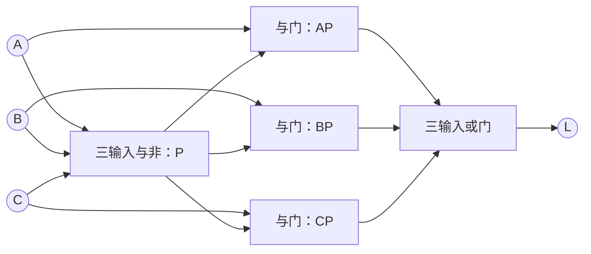
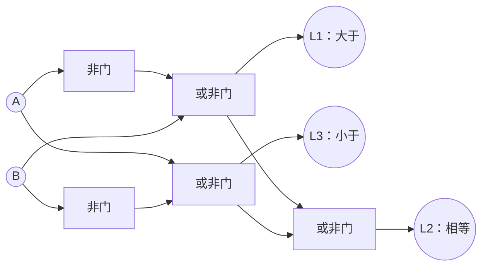
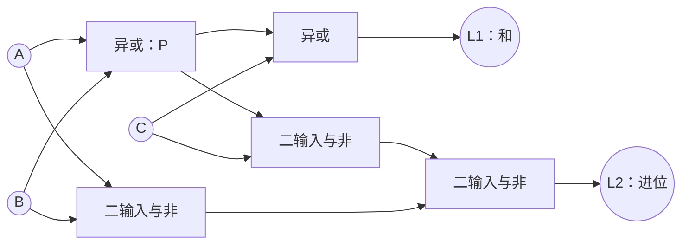
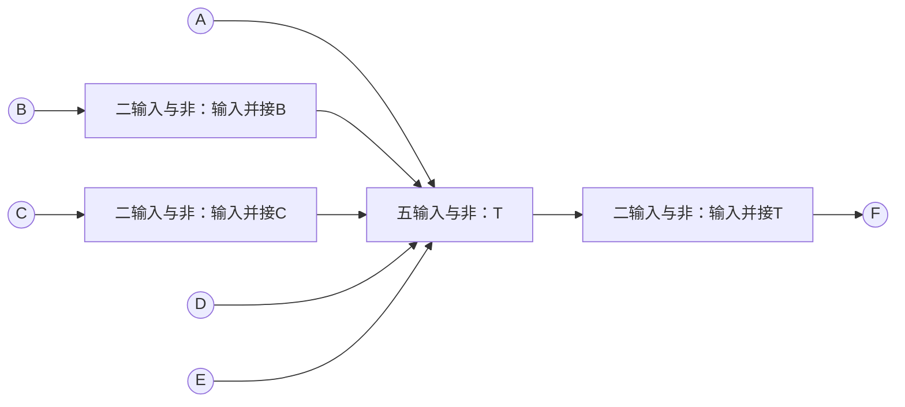
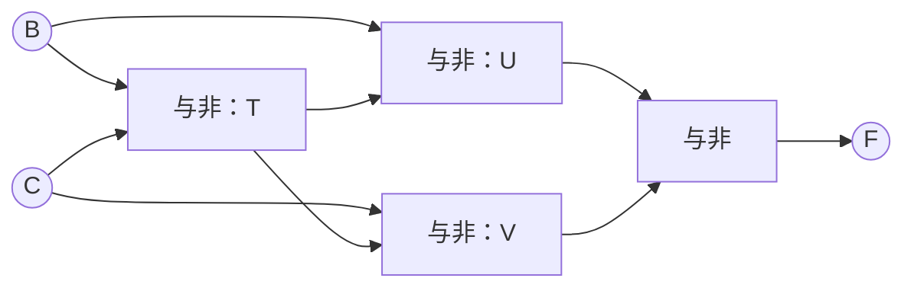
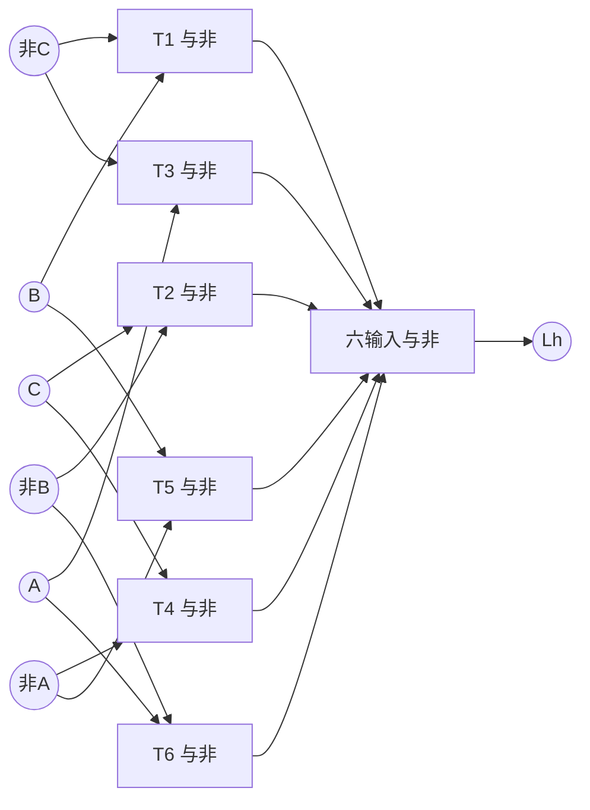
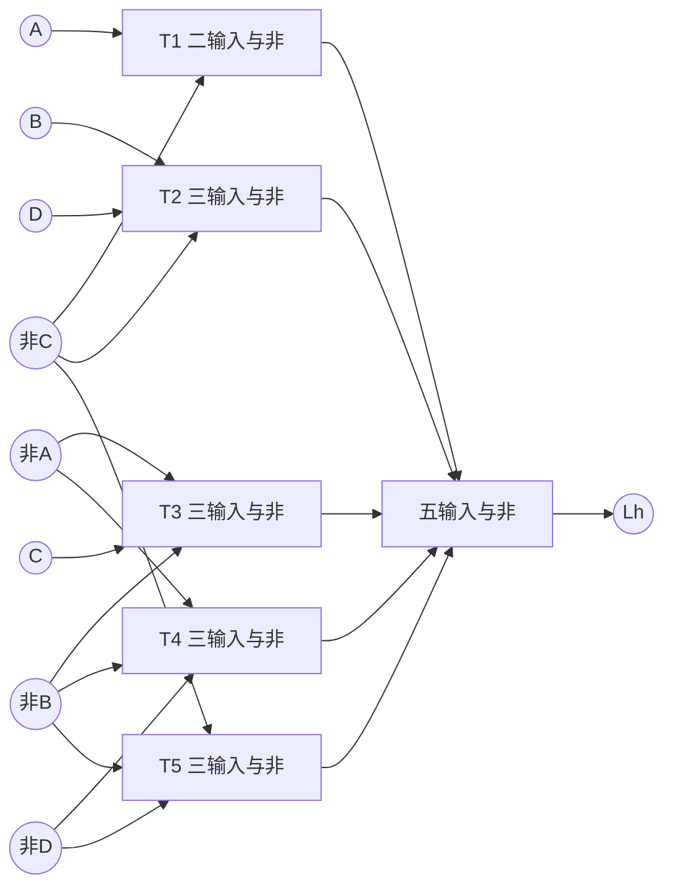
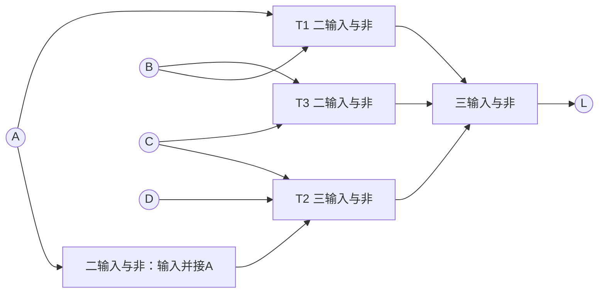
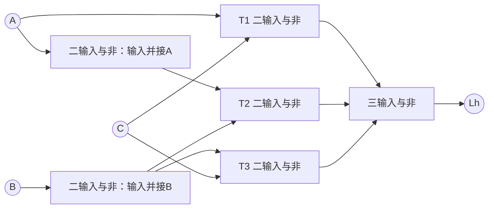

---
tags:
  - 数字逻辑
  - 组合逻辑电路
  - 作业
aliases:
  - 第7次作业组合逻辑分析与险象
---

# 第7次作业：电路分析、化简与险象

> [[ATLAS/卷9 数字逻辑与数字系统设计/目录|课程目录]] · [[ATLAS/卷9 数字逻辑与数字系统设计/第3章 组合逻辑电路/目录|第3章目录]]
> 来源：[[ATLAS/卷9 数字逻辑与数字系统设计/第3章 组合逻辑电路/附件/第7次作业.pdf|第7次作业原题（3页）]]。共3道大题、9个小问，以下推导、答案、卡诺图和重绘电路为补充解析。

## 符号与读图约定

- $+$ 表示或，连写表示与，$\oplus$ 表示异或，上横线表示取反。
- 原图中“&”为与门，“≥1”为或门，二输入“=1”为异或门；输出端小圆圈表示取反。有圆点的交叉导线才表示连接。
- $N(X,Y)=\overline{XY}$ 表示二输入与非门，反相可用 $N(X,X)$。多个参数表示相应输入数的与非门，电路图标明输入数。
- 第2题先写原图节点式，再化简和设计。第3题先按**题目原表达式所对应的门级覆盖**判断险象，再改进；不能把函数化简后直接据此断言原电路无险象。
- 本文险象分析针对输入稳定后**一次只有一个原输入改变**的静态险象。逻辑等价检查与相邻覆盖检查分开进行；多输入同时变化、实际器件延迟和动态险象需另外分析。

# 1. 分析各电路的逻辑功能

## 1（a）三变量非一致电路

原图见 [[ATLAS/卷9 数字逻辑与数字系统设计/第3章 组合逻辑电路/附件/第7次作业.pdf#page=1|PDF第1页图（a）]]，信号由下向上传递。

### 逐级写表达式

底部是三输入与非门，设其输出为 $P$；中间三个与门分别接 $A,P$、$B,P$、$C,P$，末级为或门：

$$P=\overline{ABC},\qquad L=AP+BP+CP$$

$$\boxed{L=(A+B+C)\overline{ABC}}$$

也可写为：

$$L=\sum m(1,2,3,4,5,6)=\bar AB+\bar BC+A\bar C$$

### 真值表与功能

| $ABC$ | 000 | 001 | 010 | 011 | 100 | 101 | 110 | 111 |
|:---:|:---:|:---:|:---:|:---:|:---:|:---:|:---:|:---:|
| $L$ | 0 | 1 | 1 | 1 | 1 | 1 | 1 | 0 |

**三个输入不全相同时输出1，全0或全1时输出0，因此是三变量非一致电路。** 它不同于“至少两个为1”的多数表决，也不同于奇偶检测。

### 原电路重绘

## 1（b）一位数值比较器

原图见 [[ATLAS/卷9 数字逻辑与数字系统设计/第3章 组合逻辑电路/附件/第7次作业.pdf#page=1|PDF第1页图（b）]]。左侧两个门产生 $\bar A,\bar B$，中间和末级均为或非门。

$$\begin{aligned}
L_1&=\overline{\bar A+B}=A\bar B,\\
L_3&=\overline{A+\bar B}=\bar AB,\\
L_2&=\overline{L_1+L_3}=AB+\bar A\bar B=\overline{A\oplus B}.
\end{aligned}$$

| $A$ | $B$ | $L_1$ | $L_2$ | $L_3$ |
|:---:|:---:|:---:|:---:|:---:|
| 0 | 0 | 0 | 1 | 0 |
| 0 | 1 | 0 | 0 | 1 |
| 1 | 0 | 1 | 0 | 0 |
| 1 | 1 | 0 | 1 | 0 |

$$\boxed{L_1=[A>B],\quad L_2=[A=B],\quad L_3=[A<B]}$$

即一位无符号数值比较器，正常稳定输入下三个输出恰有一个为1。

## 1（c）一位全加器

原图见 [[ATLAS/卷9 数字逻辑与数字系统设计/第3章 组合逻辑电路/附件/第7次作业.pdf#page=2|PDF第2页图（c）]]。设第一个异或门输出为 $P=A\oplus B$。

$$\begin{aligned}
L_1&=P\oplus C=A\oplus B\oplus C,\\
L_2&=\overline{\overline{PC}\cdot\overline{AB}}
=AB+(A\oplus B)C\\
&=AB+AC+BC.
\end{aligned}$$

| $ABC$ | 000 | 001 | 010 | 011 | 100 | 101 | 110 | 111 |
|:---:|:---:|:---:|:---:|:---:|:---:|:---:|:---:|:---:|
| $L_1$ | 0 | 1 | 1 | 0 | 1 | 0 | 0 | 1 |
| $L_2$ | 0 | 0 | 0 | 1 | 0 | 1 | 1 | 1 |

按算术值解释，$A+B+C=2L_2+L_1$。因此是**全加器**：$C$ 为输入进位，$L_1$ 为本位和，$L_2$ 为输出进位。

# 2. 化简逻辑表达式，并用与非门改进设计

## 2（a）五输入电路

原图见 [[ATLAS/卷9 数字逻辑与数字系统设计/第3章 组合逻辑电路/附件/第7次作业.pdf#page=2|PDF第2页图（a）]]。

### （1）原图节点式

上方或门为 $P=A+E$；中间与或非门按两组输入 $BE$、$CD$ 相与后取或非；底部与非门接 $D,E$。

$$\begin{aligned}
P&=A+E,\\
Q&=\overline{BE+CD},\\
R&=\overline{DE},\\
F&=\overline{\left[A\oplus P\right]+\left[Q\oplus D\right]+R}.
\end{aligned}$$

特别注意：输入 $E$ 接上方或门、与或非门的一组输入以及底部门；交叉导线没有圆点处不相连。

### （2）利用末级或非门的条件化简

末级要输出1，三个输入必须全部为0。

1. $R=0\Rightarrow DE=1\Rightarrow D=E=1$。
2. 在 $E=1$ 下，$A\oplus(A+E)=A\oplus1=\bar A$，为0要求 $A=1$。
3. 在 $D=E=1$ 下，$Q=\overline{B+C}$，$Q\oplus D=\overline{B+C}\oplus1=B+C$，为0要求 $B=C=0$。

反过来这五个条件也能保证三个末级输入全为0，所以：

$$\boxed{F=A\bar B\bar CDE=\sum m(19)}$$

最小项按 $ABCDE$ 从高到低编号，只有 $ABCDE=10011$ 时输出1。

### （3）与非门改进方案

先生成反变量，再将唯一积项用两次取反实现：

$$\bar B=N(B,B),\quad\bar C=N(C,C),\quad T=N(A,\bar B,\bar C,D,E),\quad F=N(T,T)$$

共4个逻辑门，其中 $T$ 为五输入与非门，其余为二输入与非门。这是门级逻辑方案，不代表特定芯片封装数量。

若限定只能使用二输入与非门，可将正极性与函数分组。先生成 $U=AD$、$V=\bar B\bar C$，再生成 $W=UV$、$F=WE$；每个二输入与函数都用“与非后自反”实现，连同 $\bar B,\bar C$ 共10个二输入与非门。

## 2（b）化简为异或函数

原图见 [[ATLAS/卷9 数字逻辑与数字系统设计/第3章 组合逻辑电路/附件/第7次作业.pdf#page=3|PDF第3页图（b）]]，信号向上传递。底部输入中有给定的 $\bar A$ 和 $\bar C$。

### （1）逐级分析

左下与非门输出 $P=\overline{AB}$；中下或非门输出 $Q=\overline{\bar A+C}=A\bar C$；左侧上一级为与门。右侧二输入“=1”门为异或门，输入 $B,\bar C$。

$$F=\overline{PQ+(B\oplus\bar C)}$$

其中：

$$PQ=(\bar A+\bar B)A\bar C=A\bar B\bar C$$

$$B\oplus\bar C=BC+\bar B\bar C$$

利用吸收律：

$$\begin{aligned}
F&=\overline{A\bar B\bar C+BC+\bar B\bar C}\\
&=\overline{BC+\bar B\bar C}\\
&=\boxed{\bar BC+B\bar C=B\oplus C}.
\end{aligned}$$

$A$ 被吸收，不再影响输出。

|    $BC$     | 00  | 01  | 10  | 11  |
| :---------: | :-: | :-: | :-: | :-: |
| $F$（任意 $A$） |  0  |  1  |  1  |  0  |

### （2）全部使用二输入与非门

$$T=N(B,C),\quad U=N(B,T),\quad V=N(C,T),\quad F=N(U,V)$$

共4个二输入与非门，不需要单独提供反变量。

# 3. 判断、消除险象，并用与非门实现

原题4个函数均见 [[ATLAS/卷9 数字逻辑与数字系统设计/第3章 组合逻辑电路/附件/第7次作业.pdf#page=3|PDF第3页]]。下面用 $L_h$ 表示改进后的实现，其稳定逻辑值与原 $L$ 相同。

## 3（1）卡诺图法：三变量函数

### （1）准确抄写原函数

$$L=B\bar C+\bar BC+A\bar C+A\bar B\bar C+\bar ABC$$

$$L=\sum m(1,2,3,4,5,6)$$

其中 $A\bar B\bar C$ 已被 $A\bar C$ 包含，但先按原式标出各项的覆盖，再判断险象。

### （2）画卡诺图，标原有圈

列 $AB=00,01,11,10$，行 $C=0,1$。格内括号为最小项编号。

| $C\backslash AB$ | 00 | 01 | 11 | 10 |
|:---:|:---:|:---:|:---:|:---:|
| 0 | 0（$m_0$） | 1（$m_2$） | 1（$m_6$） | 1（$m_4$） |
| 1 | 1（$m_1$） | 1（$m_3$） | 0（$m_7$） | 1（$m_5$） |

| 原积项 | 对应卡诺圈 |
|---|---|
| $B\bar C$ | $\{2,6\}$ |
| $\bar BC$ | $\{1,5\}$，左右边界环绕相邻 |
| $A\bar C$ | $\{4,6\}$ |
| $A\bar B\bar C$ | $\{4\}$，包含在已有圈中 |
| $\bar ABC$ | $\{3\}$ |

以下三对相邻1格没有共同圈，单变量变化时可能产生静态1险象，即本应保持1却出现负毛刺：

| 相邻1格 | 固定条件及改变变量 | 新增圈/冗余项 |
|---|---|---|
| $m_1\leftrightarrow m_3$ | $A=0,C=1$，$B$ 改变 | $\bar AC$ |
| $m_2\leftrightarrow m_3$ | $A=0,B=1$，$C$ 改变 | $\bar AB$ |
| $m_4\leftrightarrow m_5$ | $A=1,B=0$，$C$ 改变 | $A\bar B$ |

### （3）增加覆盖并去掉已被包含的单格项

$$\boxed{L_h=B\bar C+\bar BC+A\bar C+\bar AC+\bar AB+A\bar B}$$

六个两格圈覆盖全部六对相邻1格。原来的单格项 $A\bar B\bar C$、$\bar ABC$ 均可去掉，因为其覆盖已由上述圈保持。

> [!note] 不能再次只追求项数最少
> 该函数可化为三项的非一致函数，但仅保留三项会再次出现没有共同覆盖的相邻1格。这里保留六项是为了保持单输入变化时的连续覆盖。

### （4）与非门实现

先用二输入与非门生成 $\bar A,\bar B,\bar C$，再令：

$$\begin{aligned}
T_1&=N(B,\bar C),&T_2&=N(\bar B,C),&T_3&=N(A,\bar C),\\
T_4&=N(\bar A,C),&T_5&=N(\bar A,B),&T_6&=N(A,\bar B),\\
L_h&=N(T_1,T_2,T_3,T_4,T_5,T_6).
\end{aligned}$$

这是六个积项的两级与非实现。末级为六输入与非门，含3个反相门共10个门。

## 3（2）卡诺图法：四变量函数

### （1）原函数与最小项

$$\begin{aligned}
L={}&AB\bar C+\bar A\bar B\bar C\bar D+\bar AB\bar CD\\
&+A\bar B\bar C+\bar A\bar BC+AB\bar CD.
\end{aligned}$$

最后一项 $AB\bar CD$ 被第一项 $AB\bar C$ 包含。按 $ABCD$ 编号：

$$L=\sum m(0,2,3,5,8,9,12,13)$$

### （2）卡诺图与原有覆盖

列 $AB$、行 $CD$ 都按 $00,01,11,10$ 排列。

| $CD\backslash AB$ | 00 | 01 | 11 | 10 |
|:---:|:---:|:---:|:---:|:---:|
| 00 | 1（$m_0$） | 0（$m_4$） | 1（$m_{12}$） | 1（$m_8$） |
| 01 | 0（$m_1$） | 1（$m_5$） | 1（$m_{13}$） | 1（$m_9$） |
| 11 | 1（$m_3$） | 0（$m_7$） | 0（$m_{15}$） | 0（$m_{11}$） |
| 10 | 1（$m_2$） | 0（$m_6$） | 0（$m_{14}$） | 0（$m_{10}$） |

| 原积项 | 覆盖最小项 |
|---|---|
| $AB\bar C$ | 12、13 |
| $\bar A\bar B\bar C\bar D$ | 0 |
| $\bar AB\bar CD$ | 5 |
| $A\bar B\bar C$ | 8、9 |
| $\bar A\bar BC$ | 2、3 |
| $AB\bar CD$ | 13，已在第一项内 |

### （3）查出所有危险相邻1格

| 相邻格    | 改变变量 | 新增共同覆盖                    |
| ------ | ---- | ------------------------- |
| 0 ↔ 2  | $C$  | $\bar A\bar B\bar D$，圈0、2 |
| 0 ↔ 8  | $A$  | $\bar B\bar C\bar D$，圈0、8 |
| 5 ↔ 13 | $A$  | $B\bar CD$，圈5、13          |
| 8 ↔ 12 | $B$  | $A\bar C$，四格圈8、9、12、13    |
| 9 ↔ 13 | $B$  | 同一个四格圈 $A\bar C$          |

因此原电路存在静态1险象。增加这些圈，再合并被包含的项，得到：

$$\boxed{L_h=A\bar C+B\bar CD+\bar A\bar BC+\bar A\bar B\bar D+\bar B\bar C\bar D}$$

最终五个圈为 $\{8,9,12,13\}$、$\{5,13\}$、$\{2,3\}$、$\{0,2\}$、$\{0,8\}$。其中0↔2跨上下边界，0↔8跨左右边界，检查时不能遗漏环绕相邻。
 
### （4）与非门实现

$$\begin{aligned}
T_1&=N(A,\bar C),\\
T_2&=N(B,\bar C,D),\\
T_3&=N(\bar A,\bar B,C),\\
T_4&=N(\bar A,\bar B,\bar D),\\
T_5&=N(\bar B,\bar C,\bar D),\\
L_h&=N(T_1,T_2,T_3,T_4,T_5).
\end{aligned}$$

末级为五输入与非门。四个反变量分别用输入并接的二输入与非门生成，合计10个门。

## 3（3）代数法：原电路已无该类险象

$$L=AB+\bar ACD+BC$$

### （1）确定需要检查的变量

只有 $A$ 同时以原变量和反变量出现。令其他输入固定：

$$L=A\cdot B+\bar A\cdot(CD)+BC$$

要使 $AB$ 与 $\bar ACD$ 在 $A$ 变化前后交接并维持输出1，必须有 $B=1,CD=1$，即 $B=C=D=1$。但这时 $BC=1$，始终将输出保持为1，不受 $A$ 的变化影响。

### （2）用共识项进一步说明

$AB$ 与 $\bar ACD$ 的共识项为 $BCD$；由于 $BCD$ 已被原式中的 $BC$ 包含，危险交接已经被覆盖：

$$BC+BCD=BC$$

因此：

$$\boxed{\text{原两级与或实现无单输入变化导致的静态1险象，无需添加冗余项。}}$$

> [!warning] 本题不能误删 $BC$
> $BC$ 不仅覆盖交接，还影响稳态功能。例如 $A=0,B=1,C=1,D=0$ 时，$AB=\bar ACD=0$ 而 $BC=1$。它不是可以删去的冗余项。

### （3）与非门实现

$$\bar A=N(A,A),\quad T_1=N(A,B),\quad T_2=N(\bar A,C,D),\quad T_3=N(B,C),\quad L=N(T_1,T_2,T_3)$$

共5个门，其中 $T_2$ 和末级为三输入与非门。

## 3（4）代数法：或与式的静态0险象

$$L=(A+\bar B)(\bar A+C)$$

### （1）找出竞争条件

只有 $A$ 同时以原变量和反变量出现。令 $B=1,C=0$，得到：

$$L=A\bar A=0$$

理论上 $A$ 改变前后输出均为0，但两条路径延迟不同时，两个和项可能短暂同时为1，产生**静态0险象（正毛刺）**。

### （2）增加冗余和项

根据共识定理的对偶形式：

$$(X+Y)(\bar X+Z)=(X+Y)(\bar X+Z)(Y+Z)$$

增加 $(\bar B+C)$，它在 $B=1,C=0$ 时恒为0：

$$\boxed{L_h=(A+\bar B)(\bar A+C)(\bar B+C)}$$

新增和项不改变稳定逻辑值，却使危险交接期间仍有一个因子保持0。

### （3）转换为与非门实现

将等价函数写为与或式，并保留共识项：

$$\boxed{L_h=AC+\bar A\bar B+\bar BC}$$

这里 $\bar BC$ 是 $AC$ 与 $\bar A\bar B$ 的共识项，不能在实现时再次删除，否则会在 $B=0,C=1$、$A$ 改变时引入静态1险象。原或与结构的正毛刺与新与或结构的负毛刺检查条件不同，需分别按具体结构判断。

$$\bar A=N(A,A),\quad\bar B=N(B,B)$$

$$T_1=N(A,C),\quad T_2=N(\bar A,\bar B),\quad T_3=N(\bar B,C),\quad L_h=N(T_1,T_2,T_3)$$

共6个门，末级为三输入与非门，其余为二输入与非门。

## 答案速查

| 小问 | 结果 |
|---|---|
| 1（a） | 三变量非一致电路，$L=(A+B+C)\overline{ABC}$ |
| 1（b） | 一位比较器，$L_1=A\bar B$、$L_2=\overline{A\oplus B}$、$L_3=\bar AB$ |
| 1（c） | 全加器，$L_1=A\oplus B\oplus C$、$L_2=AB+AC+BC$ |
| 2（a） | $F=A\bar B\bar CDE$ |
| 2（b） | $F=B\oplus C$，4个二输入与非门 |
| 3（1） | 有险象；补圈 $\bar AC,\bar AB,A\bar B$ |
| 3（2） | 有险象；补圈 $\bar A\bar B\bar D,\bar B\bar C\bar D,B\bar CD,A\bar C$ |
| 3（3） | 原实现无单输入静态1险象；$BC$ 已覆盖共识项 $BCD$ |
| 3（4） | 原或与式有静态0险象；加和项 $(\bar B+C)$，再以三项与或式作与非实现 |

## 核验范围

逐一比较了各小问全部输入下的原图/原表达式与答案，并核对第3题所有相邻1格的共同覆盖及第3（4）题相邻0格的共同覆盖。该验证证明稳态等价与上述单输入静态险象覆盖，不代替器件级延迟仿真。

第3题的5、6输入与非门是明确标注输入数的逻辑门。若改用二输入门或具体集成芯片，应按正确极性分解，并重新检查新的多级结构；不能将多输入与非门简单串接后沿用原两级电路的险象结论。

相关笔记：[[组合逻辑电路分析]]、[[组合逻辑电路的竞争与险象]]、[[布尔函数的卡诺图化简]]、[[数值比较器]]、[[加法器]]。
