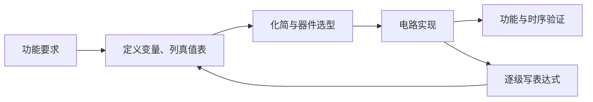

---
tags:
  - 数字逻辑
  - 组合逻辑电路
aliases:
  - 组合逻辑电路概述
---

> [[ATLAS/卷9 数字逻辑与数字系统设计/目录|课程目录]] · [[ATLAS/卷9 数字逻辑与数字系统设计/第3章 组合逻辑电路/目录|第3章目录]]
> 来源：[[ATLAS/卷9 数字逻辑与数字系统设计/第3章 组合逻辑电路/附件/第3章组合逻辑.pdf#page=2|课件 PDF 第2–5页]]。页码按 PDF 阅读器计；推导和练习答案含补充解析。

# 1. 模型与特点

组合逻辑电路的稳定输出只由当前输入决定，与过去输入及历史状态无关：

$$Z_i=f_i(X_1,X_2,\ldots,X_n),\qquad i=1,\ldots,m$$

同一组输入必须对应同一组稳定输出。通常由逻辑门构成，不包含用于记忆历史状态的存储单元。引入存储元件后，输出还可能与历史状态有关，见 [[时序机与时序逻辑电路]]。

> [!note] 逻辑模型与实际延迟
> 课件的“任何时刻只取决于该时刻的输入”是理想逻辑描述。实际电路有传播延迟，输入改变后输出需要一段时间才稳定，期间还可能出现 [[组合逻辑电路的竞争与险象|险象]]。有时序图不代表电路就是时序逻辑电路。

# 2. 五种描述方法

| 描述方法 | 主要内容 | 用途 |
|---|---|---|
| 真值表 | 所有输入组合及输出 | 完整定义逻辑功能 |
| 布尔函数表达式 | 输入与输出的代数关系 | 化简、转换门类型 |
| 原理图 | 门或集成器件及连接 | 表达具体实现 |
| HDL语言 | 用硬件描述语言描述功能或结构 | 仿真、综合 |
| 时序图 | 输入输出随时间变化的波形 | 观察功能、延迟及瞬态行为 |

一个输入数为 $n$ 的完全确定函数有 $2^n$ 种输入组合。仅看到几个波形区间，不能推断未出现组合的输出。

# 3. 真值表与时序图互换

1. 按输入变化时刻将波形划分为若干区间。
2. 在每个稳定区间读取输入向量及输出。
3. 将输入按二进制顺序归入真值表；重复组合应有相同稳定输出。
4. 反向绘图时，逐区间查表确定输出；若考虑真实器件，再标注传播延迟。

课件第5页例题：

$$F(A,B,C)=AB+BC=B(A+C)$$

| $ABC$ | 000 | 001 | 010 | 011 | 100 | 101 | 110 | 111 |
|---|---|---|---|---|---|---|---|---|
| $F$ | 0 | 0 | 0 | 1 | 0 | 0 | 1 | 1 |

$B=1$ 且 $A,C$ 至少一个为1时输出为1。课件第12–15页另一个波形题为 $F=A(B+C)$，两者不能混淆。

# 4. 本章学习主线

从功能到电路见 [[组合逻辑电路的设计]]；从电路到功能见 [[组合逻辑电路分析]]。实现方案既要满足逻辑正确性，也要考虑门数、级数、扇出、速度和瞬态可靠性。
