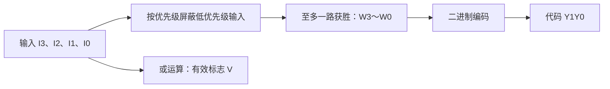

---
tags:
  - 数字逻辑
  - 组合逻辑电路
aliases:
  - 普通编码器
  - 优先编码器
  - 二进制编码器
---

> [[ATLAS/卷9 数字逻辑与数字系统设计/目录|课程目录]] · [[ATLAS/卷9 数字逻辑与数字系统设计/第3章 组合逻辑电路/目录|第3章目录]]

# 1. 编码器的基本概念

编码是用一组二进制代码表示某个输入信号的编号或含义。**编码器把被激活的输入线转换为相应代码**。

若要区分 $N$ 种输入事件，编码位数 $n$ 至少满足：

$$
2^n\ge N,\qquad n\ge\lceil\log_2N\rceil
$$

例如8线—3线编码器把8种输入事件编码为3位二进制数；十进制编码器把十进制数字0～9编码为4位BCD码。

| 类型 | 输入约束或处理规则 |
|---|---|
| 普通编码器 | 正常编码时只允许一条输入有效 |
| 优先编码器 | 允许多条输入同时有效，只输出优先级最高者的代码 |

> [!note] 本文约定
> 理论推导先采用高电平有效输入和原码输出，$+$ 表示或。器件小节单独说明低电平有效与反码输出，不能直接混用。

# 2. 普通二进制编码器

## 2.1 4线—2线编码器

输入为 $I_0,I_1,I_2,I_3$，输出为 $Y_1,Y_0$，其中 $Y_1$ 是高位。规定正常输入中恰有一个 $I_k=1$，输出即为 $k$ 的二进制表示。

| $I_3$ | $I_2$ | $I_1$ | $I_0$ | $Y_1$ | $Y_0$ |
|:---:|:---:|:---:|:---:|:---:|:---:|
| 0 | 0 | 0 | 1 | 0 | 0 |
| 0 | 0 | 1 | 0 | 0 | 1 |
| 0 | 1 | 0 | 0 | 1 | 0 |
| 1 | 0 | 0 | 0 | 1 | 1 |

观察哪些输入应使相应输出位为1，可得：

$$
\boxed{Y_1=I_2+I_3},\qquad \boxed{Y_0=I_1+I_3}
$$

因此可用两个或门实现。

## 2.2 无输入与多输入问题

当所有输入为0时，上式输出00，与 $I_0=1$ 时相同。可增加有效标志：

$$
V=I_0+I_1+I_2+I_3
$$

$V=0$ 表示没有输入有效；$V=1$ 表示至少有一路输入有效，**不能据此认定恰好只有一路有效**。

如果 $I_1=I_2=1$，两条输出都为1，形成11，但 $I_3$ 并未有效。因此普通编码器要求外部保证输入互斥，或者另设多输入检测逻辑。

> [!warning] 不满足约束不等于没有电平
> 多路有效时，实际门电路仍会输出确定电平，只是该输出不再满足普通编码器的预定含义。设计中只有确定不会出现、或明确不要求输出的输入组合，才能作为无关项处理。

## 2.3 8线—3线编码器

在输入恰有一路为1的前提下：

$$
\begin{aligned}
Y_2&=I_4+I_5+I_6+I_7\\
Y_1&=I_2+I_3+I_6+I_7\\
Y_0&=I_1+I_3+I_5+I_7
\end{aligned}
$$

通用方法：把编号的第 $j$ 位为1的所有输入线相或，得到输出 $Y_j$。例如 $I_5=1$ 时输出101。

# 3. 优先编码器

## 3.1 4线—2线优先编码器

规定优先级 $I_3>I_2>I_1>I_0$，输入仍为高电平有效。

| $I_3$ | $I_2$ | $I_1$ | $I_0$ | $Y_1$ | $Y_0$ | $V$ |
|:---:|:---:|:---:|:---:|:---:|:---:|:---:|
| 1 | × | × | × | 1 | 1 | 1 |
| 0 | 1 | × | × | 1 | 0 | 1 |
| 0 | 0 | 1 | × | 0 | 1 | 1 |
| 0 | 0 | 0 | 1 | 0 | 0 | 1 |
| 0 | 0 | 0 | 0 | 0 | 0 | 0 |

这里的“×”表示该输入可取0或1，输出均不改变；例如第一行覆盖 $I_3=1$ 的全部8种输入组合。无输入时将代码规定为00，并通过 $V=0$ 标记无效。

## 3.2 表达式推导

高位代码为1，当且仅当最高有效输入是 $I_2$ 或 $I_3$：

$$
\boxed{Y_1=I_3+I_2}
$$

低位代码为1，当且仅当 $I_3$ 有效，或 $I_3,I_2$ 均无效而 $I_1$ 有效：

$$
Y_0=I_3+\bar I_3\bar I_2I_1
=\boxed{I_3+\bar I_2I_1}
$$

$$
V=I_3+I_2+I_1+I_0
$$

例如 $I_2=I_1=1,I_3=0$ 时，普通编码器会输出11，优先编码器输出10，正确表示优先级更高的 $I_2$。

## 3.3 先屏蔽，再编码

可以先构造“获胜输入” $W_i$：

$$
\begin{aligned}
W_3&=I_3\\
W_2&=\bar I_3I_2\\
W_1&=\bar I_3\bar I_2I_1\\
W_0&=\bar I_3\bar I_2\bar I_1I_0
\end{aligned}
$$

这些信号至多有一个为1，再按普通编码器的方法得到 $Y_1=W_2+W_3$、$Y_0=W_1+W_3$。

# 4. 十进制到8421 BCD编码

8421 BCD用4位二进制代码表示**一位十进制数字**。对高有效、输入互斥的 $I_0\sim I_9$：

$$
\begin{aligned}
Y_3&=I_8+I_9\\
Y_2&=I_4+I_5+I_6+I_7\\
Y_1&=I_2+I_3+I_6+I_7\\
Y_0&=I_1+I_3+I_5+I_7+I_9
\end{aligned}
$$

例如 $I_9=1$ 时输出1001；1010～1111不是一位十进制数字的合法8421 BCD码。十进制数12的BCD表示为 $0001\,0010$，普通二进制表示则为1100，两者不能混淆。

# 5. 常用器件：74LS148

74LS148是8线—3线优先编码器，编号7的输入优先级最高。数据输入低电平有效，代码输出为所选编号的逐位反码；$EI=0$ 时使能。以下符号直接表示引脚电平。[TI 数据手册，第2–3页](https://www.ti.com/lit/ds/symlink/sn74ls148.pdf)

| 状态 | $EI$ | $A_2A_1A_0$ | $GS$ | $EO$ |
|---|:---:|:---:|:---:|:---:|
| 禁止编码 | 1 | 111 | 1 | 1 |
| 使能，但数据输入全为1 | 0 | 111 | 1 | 0 |
| 使能，至少一路数据输入为0 | 0 | 最高优先级有效输入编号的反码 | 0 | 1 |

例如输入5和输入2同时为0，其余数据输入为1，则选择5，$A_2A_1A_0=010$。代码111既可能表示选中输入0，也可能表示无请求，需结合 $GS$ 区分。[功能表](https://www.ti.com/lit/ds/symlink/sn74ls148.pdf#page=3)

扩展时可将高优先级芯片的 $EO$ 接低优先级芯片的 $EI$：高组无请求时才允许低组工作；输出代码还需合成逻辑，不能直接并接。[级联应用](https://www.ti.com/lit/ds/symlink/sn74ls148.pdf)

# 6. 易错点

1. 编码器编码的是**有效输入线的编号**，不是把输入向量当作一个二进制数转换。
2. 普通编码器依赖输入互斥；优先编码器允许同时有效，但只保留一个最高优先级请求。
3. “没有有效输入”和“第0路有效”应通过有效标志区分。
4. 读器件功能表时，先确认输入极性、输出极性、位序和使能条件。

相关笔记：[[译码器]]、[[完全确定与不完全确定布尔函数]]、[[布尔函数的代数化简]]。
# 课件对照与补充

> 来源：[[ATLAS/卷9 数字逻辑与数字系统设计/第3章 组合逻辑电路/附件/第3章组合逻辑.pdf#page=49|课件 PDF 第49–54页]]。以下补充课件中的实现与应用。

## 八线三线优先编码的一般表达式

课件的原理推导采用高有效输入，规定 $I_7$ 优先级最高。定义获胜信号：

$$W_i=I_i\prod_{j=i+1}^{7}\bar I_j,\qquad i=0,\ldots,7$$

其中空乘积为1，故 $W_7=I_7$。再编码：

$$A_2=W_4+W_5+W_6+W_7,\quad A_1=W_2+W_3+W_6+W_7,\quad A_0=W_1+W_3+W_5+W_7$$

该写法直接体现“本路有效且所有更高优先级均无效”，比直接抄写长展开式更便于检查。$V=\sum_{i=0}^7 I_i$ 可作请求有效标志。

课件第53–54页的74148实际采用低有效数据输入和反码输出，不能直接使用前面高有效公式。其使能、无请求及有请求三种状态与本文第5节一致；课件还列出74147为二-十进制优先编码器。

输入数量 $M$、最少代码位数 $n$ 满足 $2^{n-1}<M\le2^n$（$M>1$）；若只问足够编码而不要求最少位数，则条件是 $M\le2^n$。
