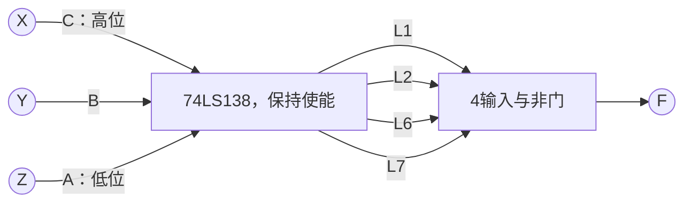

---
tags:
  - 数字逻辑
  - 组合逻辑电路
aliases:
  - 二进制译码器
  - 显示译码器
  - 3线8线译码器
---

> [[ATLAS/卷9 数字逻辑与数字系统设计/目录|课程目录]] · [[ATLAS/卷9 数字逻辑与数字系统设计/第3章 组合逻辑电路/目录|第3章目录]]

# 1. 译码器的基本概念

译码是把输入代码转换为相应的输出信号。常见译码器有：

| 类型 | 输入 | 输出含义 |
|---|---|---|
| 二进制译码器 | $n$ 位二进制代码 | 从 $2^n$ 条输出线中选中一条 |
| BCD—十进制译码器 | 4位BCD代码 | 对合法数字0～9选中相应输出线 |
| 显示译码器 | 数字代码 | 产生数码管各段的点亮信号，可同时点亮多段 |

二进制译码器也称 $n$ 线—$2^n$ 线译码器。例如3线—8线译码器把000～111分别对应到8条输出线。

> [!note] 本文约定
> 理论部分以 $A_2,A_1,A_0$ 表示从高位到低位的输入，$E=1$ 表示使能。$+$ 表示逻辑或，连写表示逻辑与。高有效输出用 $Y_i$，低有效输出引脚电平用 $L_i$ 表示，避免混淆选中状态和实际电平。

# 2. 二进制译码器

## 2.1 2线—4线译码器

对于高电平有效输出，功能表如下。禁用时没有输出被选中。

| $E$ | $A_1$ | $A_0$ | $Y_0$ | $Y_1$ | $Y_2$ | $Y_3$ |
|:---:|:---:|:---:|:---:|:---:|:---:|:---:|
| 0 | × | × | 0 | 0 | 0 | 0 |
| 1 | 0 | 0 | 1 | 0 | 0 | 0 |
| 1 | 0 | 1 | 0 | 1 | 0 | 0 |
| 1 | 1 | 0 | 0 | 0 | 1 | 0 |
| 1 | 1 | 1 | 0 | 0 | 0 | 1 |

根据每条输出取1的条件：

$$
\begin{aligned}
Y_0&=E\bar A_1\bar A_0,&Y_1&=E\bar A_1A_0,\\
Y_2&=EA_1\bar A_0,&Y_3&=EA_1A_0
\end{aligned}
$$

可用反相器产生反变量，再用4个与门分别实现。

## 2.2 3线—8线译码器与最小项

按变量顺序 $A_2,A_1,A_0$ 编号，输出表达式为：

$$
\begin{aligned}
Y_0&=E\bar A_2\bar A_1\bar A_0,&Y_1&=E\bar A_2\bar A_1A_0,\\
Y_2&=E\bar A_2A_1\bar A_0,&Y_3&=E\bar A_2A_1A_0,\\
Y_4&=EA_2\bar A_1\bar A_0,&Y_5&=EA_2\bar A_1A_0,\\
Y_6&=EA_2A_1\bar A_0,&Y_7&=EA_2A_1A_0
\end{aligned}
$$

即：

$$
\boxed{Y_i=E\cdot m_i(A_2,A_1,A_0)}
$$

使能时，每条输出对应一个 [[最小项与最大项|最小项]]。对稳定输入，恰有一条输出为1，其余为0，称为独热输出。

## 2.3 低电平有效输出

若选中的输出为0、未选中的输出为1，则：

$$
\boxed{L_i=\overline{E\cdot m_i}}
$$

- $E=1$：$L_i=\bar m_i$，恰有一条输出为0。
- $E=0$：所有输出为1。

例如输入101时，高有效译码器的 $Y_5=1$；低有效译码器的 $L_5=0$。两者都表示“选中第5路”。

# 3. 常用器件：74LS138

74LS138具有3个地址输入和8个低有效输出。其地址引脚名称为 $C,B,A$，权值依次为4、2、1，即 $A$ 是最低位。使能端为 $G_1$、$\overline{G_{2A}}$、$\overline{G_{2B}}$。[TI 数据手册](https://www.ti.com/lit/ds/symlink/sn74ls138.pdf)

令 $g_1,g_{2A},g_{2B}$ 表示三个使能引脚的实际电平，则内部总使能条件为：

$$
E=g_1\bar g_{2A}\bar g_{2B}
$$

也就是 $G_1$ 接1，两个低有效使能端都接0时工作；否则8路输出全为1。工作时 $CBA=k$，第 $k$ 路输出为0，其余为1。[功能表，第2页](https://www.ti.com/lit/ds/symlink/sn74ls138.pdf#page=2)

> [!warning] 变量顺序不能按字母名称猜
> 若函数按 $F(X,Y,Z)$ 编号，$X$ 为最高位，则接线应为 $C\leftarrow X$、$B\leftarrow Y$、$A\leftarrow Z$。把 $X$ 接到最低位 $A$ 会改变最小项编号。

# 4. 用译码器实现组合逻辑函数

## 4.1 高有效输出：译码器加或门

任意 $n$ 变量布尔函数都能写成若干最小项之和。只要译码器产生全部最小项，再将需要的输出相或即可。

例如：

$$
F(X,Y,Z)=\sum m(1,2,6,7)
$$

将 $X,Y,Z$ 按高位到低位送入3线—8线译码器，并保持使能，则：

$$
F=Y_1+Y_2+Y_6+Y_7
$$

## 4.2 低有效输出：译码器加与非门

若使用74LS138一类低有效输出译码器，使能时 $L_i=\bar m_i$。由德·摩根定理：

$$
\begin{aligned}
F&=m_1+m_2+m_6+m_7\\
&=\overline{\bar m_1\bar m_2\bar m_6\bar m_7}\\
&=\boxed{\overline{L_1L_2L_6L_7}}
\end{aligned}
$$

因此把这4条输出接入一个4输入与非门。



> [!warning] 输出极性决定末级门型
> 高有效最小项输出用或门合成；低有效最小项输出用与非门合成。不能把若干推挽输出直接接在一起代替逻辑门。

## 4.3 例题：用一片译码器实现全加器

按变量顺序 $A,B,C_{\mathrm{in}}$，由 [[加法器]] 的真值表得到：

$$
S=\sum m(1,2,4,7),\qquad C_{\mathrm{out}}=\sum m(3,5,6,7)
$$

将 $A,B,C_{\mathrm{in}}$ 分别接到74LS138的 $C,B,A$ 地址端，保持使能，得到：

$$
\boxed{S=\overline{L_1L_2L_4L_7}},\qquad
\boxed{C_{\mathrm{out}}=\overline{L_3L_5L_6L_7}}
$$

一片3线—8线译码器加两个4输入与非门即可实现两个输出。$L_7$ 同时接到两个门的输入；一条输出可以驱动多个输入，但实际接线仍需满足扇出要求。

这种方法尤其适合**多个输出共享同一组输入变量**的函数，不必为每个输出单独搭建全部最小项。

# 5. 译码器的扩展

## 5.1 用两片3线—8线译码器构成4线—16线译码器

让低3位 $A_2,A_1,A_0$ 同时送入两片地址端，用最高位 $A_3$ 选择哪一片工作：

| $A_3$ | 低组芯片 | 高组芯片 | 被选输出范围 |
|:---:|---|---|---|
| 0 | 使能 | 禁止 | 0～7 |
| 1 | 禁止 | 使能 | 8～15 |

采用74LS138时，一种接法是：

- 低组：$G_1=1$，一个低有效使能端接 $A_3$，另一个接0。
- 高组：$G_1=A_3$，两个低有效使能端均接0。
- 两片的地址端均按 $C\leftarrow A_2$、$B\leftarrow A_1$、$A\leftarrow A_0$ 连接。

这样无需额外反相器即可让两组互斥工作。输入 $A_3A_2A_1A_0=1010$ 时，高组被使能，其局部第2路输出为0，即全局第10路被选中。16路输出保持分立，不互相并接。

## 5.2 译码器与数据分配器

对于 $Y_i=E m_i$ 的高有效译码器，把数据 $D$ 接到使能端，即有 $Y_i=Dm_i$：地址选中的一路输出数据 $D$，其余输出0。

低有效输出结构则有 $L_i=\overline{Dm_i}$，选中一路得到 $\bar D$，其余为1。若使用多个使能端，应按具体引脚极性重新推导。

# 6. BCD译码与七段显示译码

BCD—十进制译码器把合法8421 BCD输入0000～1001译为十条选择线。1010～1111属于非法BCD输入；设计时应明确是否需要检测或规定其输出，不能默认所有器件的行为相同。

七段显示译码器则输出 $a,b,c,d,e,f,g$ 七个段信号。标准段位置如下：

```text
   ── a ──
  f       b
   ── g ──
  e       c
   ── d ──
```

例如显示0需要点亮 $a,b,c,d,e,f$；显示1只需点亮 $b,c$；显示8点亮全部7段。因此显示译码器不满足“每次仅一路输出有效”的条件。

| 数码管类型 | 公共端连接 | 无额外反相驱动时的段选电平 |
|---|---|---|
| 共阴极 | 阴极共接低电位 | 阳极为高时点亮 |
| 共阳极 | 阳极共接高电位 | 阴极为低时点亮 |

选择显示译码器时，需匹配输出极性和驱动能力，并按电路设计为各段限流。

# 7. 编码器与译码器的关系

| 比较项 | 编码器 | 二进制译码器 |
|---|---|---|
| 典型转换 | $2^n$ 条事件输入 → $n$ 位代码 | $n$ 位代码 → $2^n$ 条选择输出 |
| 主要问题 | 输入互斥或优先级、有效标志 | 地址位序、输出极性、使能条件 |
| 典型用途 | 请求编号、按键编码 | 地址选择、片选、实现逻辑函数 |

在码制、位序、有效极性一致且输入满足约束时，两者可以构成编码与还原关系。但优先编码器会丢弃低优先级请求，再接译码器也只能还原获胜的一路。

相关笔记：[[编码器]]、[[加法器]]、[[最小项与最大项]]、[[与非门与或非门的逻辑实现]]。
# 课件对照与补充

> 来源：[[ATLAS/卷9 数字逻辑与数字系统设计/第3章 组合逻辑电路/附件/第3章组合逻辑.pdf#page=55|课件 PDF 第55–60页]]。以下补充课件中的实现与应用。

## 用使能端实现四变量函数（第59–60页）

课件原题：

$$Y(A,B,C,D)=AB\bar C+ACD=A(B\bar C+CD)$$

按 $B,C,D$ 的高低位顺序展开括号：

$$B\bar C+CD=m_3+m_4+m_5+m_7$$

用函数变量 $A$ 接74138的高有效使能端，两个低有效使能端接0；三个地址端依次接 $B,C,D$，其中 $B$ 为最高位。

令实际低有效输出为 $L_i=\overline{A m_i(B,C,D)}$，则：

$$\boxed{Y=\overline{L_3L_4L_5L_7}}$$

当 $A=0$ 时芯片禁用，所有 $L_i=1$，末级与非门输出0；当 $A=1$ 时实现括号内函数。这样使能端已经承担变量 $A$，不需要再外加一个与门乘 $A$。

> [!warning] 一片三输入译码器不能无条件实现任意四变量函数
> 本题能这样接，是因为所有项有公共因子 $A$，且 $A=0$ 时输出恒为0。一般四变量函数需作进一步分解或扩展译码器。

课件第56页另列74139（双2线—4线）和74154（4线—16线）。第69页的多数表决函数练习见 [[组合逻辑电路综合练习#7. 用74138和与非门实现多数函数（第69页）|译码器练习]]；第70–72页的数据分配用途见 [[数据分配器]]。
